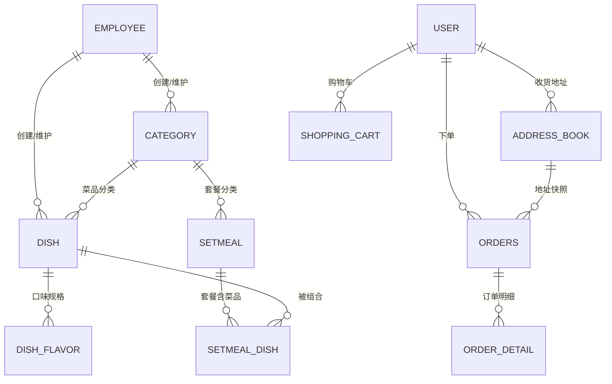
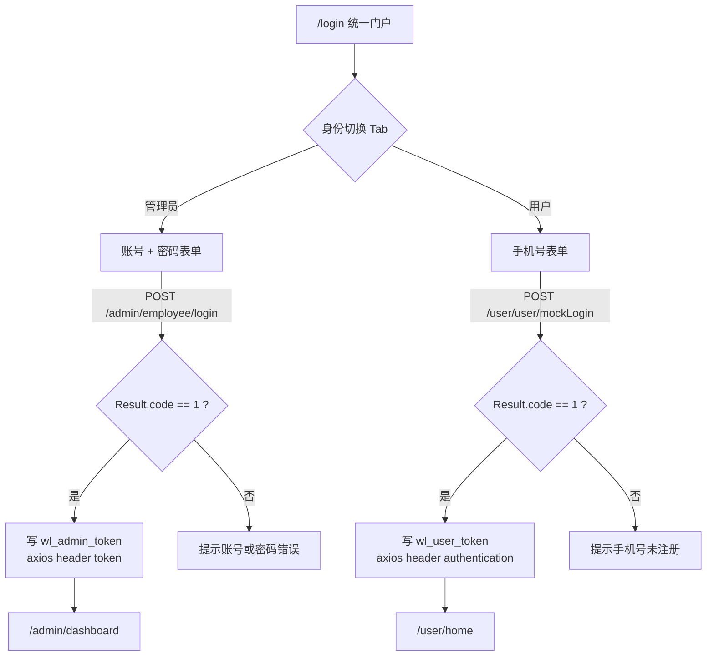
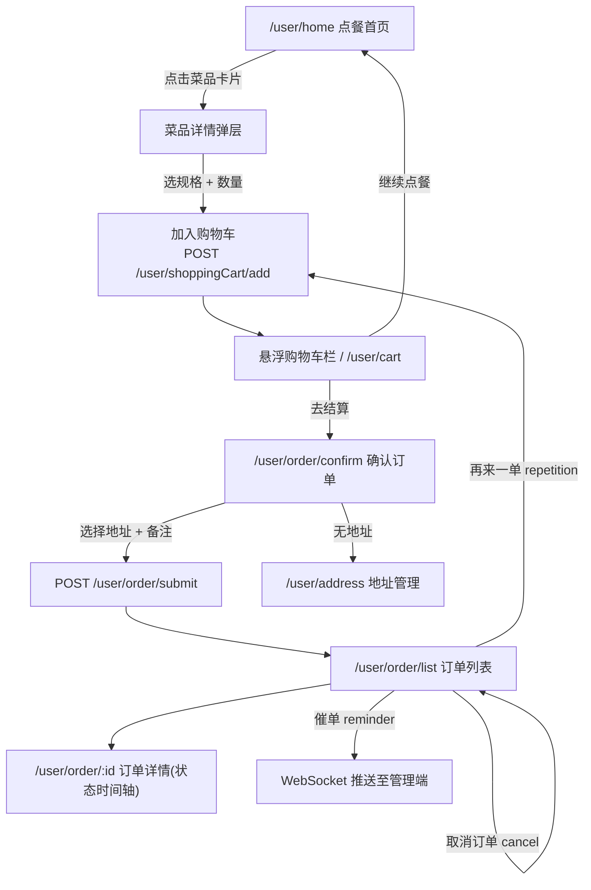
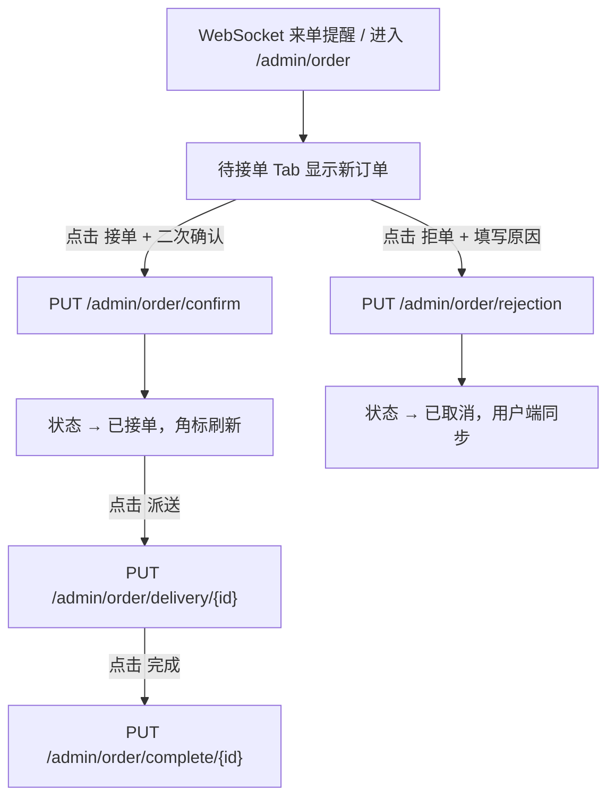

# 味来（Weilai）统一门户前端改造 PRD · v2.0（增量版）

| 项目 | 内容 |
|------|------|
| 版本 | v2.0（基于 v1.0 增量补充与修订，不推翻重写） |
| 作者 | 许清楚（产品经理） |
| 上游文档 | `味来-统一门户前端改造-PRD-v1.0.md`（14 章，核心决策全部有效） |
| 日期 | 2026-11-17 |
| 项目来源 | 黑马程序员「苍穹外卖」后端跟敲项目，品牌替换为「味来 / Weilai」 |
| 文档目的 | 在 v1.0 基础上补齐 **技术栈升级边界、数据库全新设计、双端页面原型**，作为架构设计与前后端实施的直接输入 |
| 原始需求复述 | 将跟敲的苍穹外卖后端包装成面向中小厂实习面试的简历项目：沿用品牌「味来」；依据后端接口设计全新前端页面原型与数据库表设计（接口大体不变）；重写美观的用户端 + 传统后台管理端，同一网页登录并选择身份分流；后端升级 SpringBoot 3.x / JDK17 / MyBatis-Plus，前端 Vue3 / Element-Plus / axios / vue-router；前后端分离、Result 风格；**支付功能彻底排除，不做**；部署上线后续再说 |

> **本版阅读约定**：标注 `【沿用】` 的章节直接继承 v1.0；标注 `【新增】`/`【强化】` 的章节为本轮重点交付。v1.0 的统一门户 + 角色分流、mockLogin 方案 A、CORS、FR-01~FR-10、46+ 接口清单、RTM、风险清单均继续有效。

---

## 一、版本变更说明（v1.0 → v2.0）【新增】

| 变更维度 | v1.0 口径 | v2.0 口径 | 变更原因 | 对实施的影响 |
|---------|----------|----------|---------|------------|
| 技术栈 | 沿用后端现状（SpringBoot 2.7.3 / Java 8 / 原生 MyBatis + XML + PageHelper），仅做最小增量 | **完整升级**：SpringBoot 3.x + JDK 17 + MyBatis-Plus；前端仍为 Vue3 + Element-Plus + axios + vue-router | 用户明确要求；简历需呈现主流栈 | 后端的**必改清单见第三章**；接口路径与 Result 风格**严格不变**，前端可按 v1.0 接口清单先行开发 |
| 支付 | "无真实支付，模拟状态流转"（含糊表述） | **支付彻底排除**：不新增任何支付接口/DTO/页面，orders 表保留原有 `pay_method`/`pay_status` 字段仅为兼容既有实体，不产生真实支付链路 | 用户明确"先不用管" | 前端不出现"支付"按钮与收银台；简历话术见第六章风险 RK-12 |
| 数据库 | 未涉及，沿用原库 `sky_take_out` | **全新设计**：11 张表完整结构 + ER 图 + 可执行 DDL + 优化点说明（索引/字段规范/逻辑删除与乐观锁的启用边界） | 用户要求"根据后端设计全新的数据库表设计" | 见第四章；**列名与原表保持一致**，Mapper XML 零改动即可联调 |
| 页面原型 | 仅 FR 条目文字描述 | **全新原型**：统一门户身份切换交互 + 用户端 7 类页面 + 管理端 6 类页面，含页面清单、路由、线框、视觉规范、流转图 | 用户要求"设计全新的页面原型""用户端要美观" | 见第五章；架构师据此拆前端页面组件与路由 |
| 验收标准 | 散落在各 FR 的 GWT | **集中式验收章节**，覆盖登录分流 / 用户下单 / 管理端接单三条关键链路 | 便于 QA 直接执行 | 见第六章 |
| 风险清单 | RK-01~RK-05 | 保留并新增 RK-06~RK-12（升级兼容、缓存配置、图片兜底、支付话术等） | 升级引入新风险 | 见第七章 |

**v2.0 三条硬约束（贯穿全文，架构与编码不得突破）**：

1. **接口不变**：Controller 的 URL、HTTP 方法、请求参数、DTO/VO 字段、`Result{code,msg,data}`（code=1 成功 / 0 失败）、`PageResult{total,records}` **一律不动**。
2. **克制原则**：能不改就不改。升级只为兼容性与简历表达服务，不顺手重构业务逻辑；学习主链路（双 JWT、ThreadLocal、AOP 填充、Redis 缓存、WebSocket、定时任务）保持原样。
3. **支付排除**：不新增支付接口、不新增支付页面、不引入支付 SDK；订单状态机中"待付款"仅作为**历史兼容状态**保留展示，实际下单直接流式进入"待接单"。

---

## 二、产品定义【沿用 + 强化】

### 2.1 产品目标（3 个正交目标）

| 目标 | 衡量口径 | 目标值 |
|------|----------|--------|
| G1 · 可演示闭环 | 浏览器内完成"登录 → 点餐 → 下单 → 管理端接单 → 用户端状态同步" | 1 条端到端链路跑通 |
| G2 · 技术栈可信度 | 呈现 SpringBoot3 + JDK17 + MyBatis-Plus + Vue3 双端分离，且面试官追问能答 | 升级必改项 100% 覆盖（第三章清单） |
| G3 · 简历三亮点 | 统一认证双端分流 / Redis 缓存与 MyBatis-Plus 分页 / ECharts 数据大屏 | 3 个可讲述点 |

### 2.2 用户故事（5 个）

1. As a **面试者**，I want 一个浏览器可直接演示的完整外卖项目，so that 简历不再只是"跟敲了后端"。
2. As a **招聘方**，I want 打开一个网址即可分别体验用户端与后台，so that 快速判断候选人工程能力。
3. As a **普通用户**，I want 在美观的点餐页选规格、加购物车、下单并追踪状态，so that 还原真实外卖体验。
4. As a **管理员**，I want 在标准后台接单、维护菜品套餐、看经营报表，so that 展示后端管理能力。
5. As a **面试者**，I want 升级后的代码仍能看懂且能讲清改动原因，so that 不被"这真的是你做的吗"问倒。

---

## 三、技术栈升级影响与边界【新增 · 重点】

> **一句话边界**：把"能跑起来"的兼容改动做完，把"讲得清"的技术点留下，把"不必要"的重构全部砍掉。

### 3.1 升级总览与必改清单

| 升级项 | 现状（已核实） | 目标 | 是否必改 | 改动范围与要点 |
|--------|--------------|------|---------|--------------|
| JDK | Java 8 | **JDK 17** | 必改 | `pom.xml` 的 `java.version=17`（父工程 properties）；IDE 项目 SDK 切 17；注意 JAXB 已从 JDK 移除（影响 JWT，见下） |
| Spring Boot | 2.7.3 | **3.2.x / 3.3.x（建议 3.2.5 稳态）** | 必改 | 父依赖版本；`spring.redis.*` → **`spring.data.redis.*`**；`spring.mvc.pathmatch.matching-strategy` 相关配置在 Boot3 的 WebMvc 变更需复核 |
| Servlet/注解命名空间 | `javax.*` | **`jakarta.*`** | 必改 | `javax.annotation.Resource/PostConstruct` → `jakarta.annotation.*`；`javax.servlet.http.*` → `jakarta.servlet.*`；`javax.validation.constraints.*` → `jakarta.validation.constraints.*`（需 `spring-boot-starter-validation`）；检查 `WebMvcConfiguration`、`JwtTokenAdminInterceptor`、`JwtTokenUserInterceptor`、GlobalExceptionHandler |
| ORM | 原生 MyBatis + XML + PageHelper | **MyBatis-Plus 3.5.5+**（Boot3 兼容版） | 必改 | `mybatis-spring-boot-starter` → `mybatis-plus-boot-starter`；配置前缀 `mybatis` → `mybatis-plus`；**分页插件替换 PageHelper**（见 3.3）；XML 与 `mapper-locations` 保留 |
| 分页 | `PageHelper.startPage()` + `PageInfo` | **MP `MybatisPlusInterceptor` + `PaginationInnerInterceptor`** | 必改 | 所有 `page` 查询处替换；**Controller 返回的 `PageResult{total,records}` 组装逻辑保持不变**；`PageHelper` 依赖移除（两者并存会冲突） |
| API 文档 | Knife4j / Swagger2（Springfox） | **SpringDoc OpenAPI 3**（`springdoc-openapi-starter-webmvc-ui 2.x`） | 必改 | Springfox 不兼容 Boot3；注解 `@Api`→`@Tag`、`@ApiOperation`→`@Operation`、`@ApiModel/@ApiModelProperty`→`@Schema`；访问地址由 `/doc.html` 变为 `/swagger-ui/index.html`。**仅注解层，不影响接口行为** |
| JWT | JJWT 0.9.1 | **JJWT 0.11.5 或 0.12.x**（api/impl/jackson 三件套） | 必改 | 0.9.1 依赖 `javax.xml.bind.DatatypeConverter`，JDK17 无 JAXB 会启动失败；API 从 `signWith(SignatureAlgorithm, secret)` 改为 `signWith(SecretKey, Jwts.SIG.HS256)`，解析改 `parserBuilder()`（0.12 为 `parser().verifyWith()`）。**secret（itcast / itheima）、header 名（token / authentication）、claims key（empId / userId）、过期时间一律不变 → 前端无感** |
| Spring Cache | Redis + Spring Cache 注解 | **沿用，仅适配配置** | 适配 | `@EnableCaching`、`@Cacheable/@CacheEvict` 不动；自定义 `RedisCacheManager` 配置类保留；随 Redis 配置前缀调整；菜品缓存与套餐缓存逻辑不动 |
| 公共字段填充 | AOP 自动填充 | **保留 AOP，不启用 MP 自动填充** | 不改 | 避免两套填充同时写 `createTime/updateTime` 造成覆盖混乱；简历仍可讲 AOP |
| WebSocket / 定时任务 / OSS / POI | 现有实现 | **保持原样** | 不改 | 仅随 Boot3 做编译级兼容修正，不重构 |
| Lombok | 现有 | 保持 | 不改 | 确认 IDE 安装 Lombok 插件 + JDK17 下注解处理器正常 |
| 前端 | 无前端代码 | Vue3 + Vite + Element-Plus + axios + vue-router（+ ECharts / Pinia） | 新增 | 与 v1.0 选型一致；**接口层可直接照 v1.0 附录 14.1 建立**，不受后端升级影响 |

### 3.2 MyBatis-Plus 与现有 XML 共存策略【架构师重点关注】

这是升级中**最容易踩坑**的一处，明确如下边界：

1. **继承而非替换**：各 Mapper 接口继续保留现有 `@Param` 方法与对应 XML；额外 `extends BaseMapper<XxxEntity>`。新增查询（如 mockLogin 按 phone 查 user）优先用 MP 的 `LambdaQueryWrapper`，旧 SQL 一行不动。
2. **配置前缀**：`mybatis-plus.mapper-locations=classpath*:mapper/**/*.xml`、`mybatis-plus.type-aliases-package=com.sky.entity`、`map-underscore-to-camel-case: true`（保持驼峰映射，DDL 用下划线列名）。
3. **主键策略设为 `id-type: auto`**：与原库 `AUTO_INCREMENT` 一致。**禁止**使用 MP 默认雪花 ID，否则与既有数据、接口返回、演示脚本全部冲突。
4. **不启用全局逻辑删除**：**不配置** `logic-delete-field`。一旦开启，MP 会给所有 SQL 自动追加 `WHERE deleted=0`，原库无该列会直接报错。本轮 DDL 中预留 `is_deleted` 列但默认不接入 MP 策略（见 4.5）。
5. **分页插件唯一化**：移除 PageHelper 依赖，只保留 MP 的 `PaginationInnerInterceptor(DbType.MYSQL)`。两者并存会导致分页参数错乱（典型症状：total 正确但 records 重复）。
6. **自动填充二选一**：保留现有 AOP，`MetaObjectHandler` 不注册。
7. **编译级自检**：Mapper XML 中的 `resultType`/`parameterType` 别名、`foreach` 语句在 MP starter 下需回归验证一遍（建议架构师在升级任务中列出"XML 冒烟清单"）。

### 3.3 升级风险速览（详见第七章）

| 风险 | 触发点 | 缓解 |
|------|--------|------|
| `javax` 遗漏 | 拦截器、配置类、DTO 校验注解 | 全局搜索 `javax.` 逐个替换，编译即暴露 |
| JWT 启动失败 | JDK17 无 JAXB | 升 JJWT 0.11.5+，保持 secret/claims 不变 |
| Swagger 注解冲突 | Knife4j 与 Boot3 | 换 SpringDoc，注解批量替换 |
| 分页结果异常 | PageHelper 与 MP 并存 | 二选一，回归所有分页接口 |
| 缓存配置不生效 | `spring.redis` → `spring.data.redis` | 启动后实测 `/user/dish/list` 二次走缓存 |

### 3.4 边界声明（写给架构师与工程师）

- ✅ **允许改**：pom 版本、依赖坐标、配置前缀、`javax→jakarta`、分页实现、Swagger 注解、mockLogin、CORS。
- ❌ **禁止改**：URL 路径、HTTP 方法、DTO/VO 字段名、`Result`/`PageResult` 结构、业务状态机、数据库列名与表名。
- ⏸ **暂缓**：真实支付、用户注册、微服务化、Docker/CI、qiankun 微前端。

---

## 四、数据库设计（全新）【新增 · 重点章节】

### 4.1 设计原则

| 原则 | 说明 |
|------|------|
| 零映射成本 | **表名、列名沿用原库**（`sky_take_out`，品牌库名可选 `weilai_take_out`），camelCase 实体 ↔ snake_case 列由 MyBatis 驼峰映射承接，Mapper XML 无需改动 |
| 类型规范 | 金额统一 `DECIMAL(10,2)`（禁用 float/double）；状态/标志位 `TINYINT`；主键 `BIGINT AUTO_INCREMENT` |
| 时间规范 | `create_time`/`update_time` 统一 `DATETIME DEFAULT CURRENT_TIMESTAMP ON UPDATE CURRENT_TIMESTAMP`，与 AOP 填充兼容（AOP 显式赋值优先） |
| 索引先行 | 给高频查询路径（登录、分类筛菜、订单列表、购物车、地址默认）建普通/联合索引，简历可讲"查询优化" |
| 克制增强 | 逻辑删除列、乐观锁列**预留但本轮不接入**，避免改动既有 SQL；见 4.5 |
| 支付排除 | `orders.pay_method`/`pay_status` 保留以兼容实体与 DTO，注释标明"无真实支付流程" |

### 4.2 表关系 ER 图

> 说明：沿用原项目风格，**不建物理外键**，以逻辑关联 + 索引保证查询效率；ER 图表达的是业务关联。



### 4.3 表结构明细（11 张表）

#### 4.3.1 employee（员工/管理员表）

| 字段 | 类型 | 约束/默认 | 索引 | 注释 |
|------|------|----------|------|------|
| id | BIGINT | PK, AUTO_INCREMENT | PRIMARY | 主键 |
| username | VARCHAR(64) | NOT NULL | **UNIQUE** uk_username | 登录账号 |
| name | VARCHAR(64) | NOT NULL | — | 姓名 |
| password | VARCHAR(128) | NOT NULL | — | 密码（MD5，沿用现有逻辑） |
| phone | VARCHAR(20) | DEFAULT NULL | — | 手机号 |
| sex | VARCHAR(4) | DEFAULT NULL | — | 性别 |
| id_number | VARCHAR(32) | DEFAULT NULL | — | 身份证号 |
| status | TINYINT | NOT NULL DEFAULT 1 | INDEX idx_status | 状态 0禁用 1启用 |
| create_time | DATETIME | NOT NULL DEFAULT CURRENT_TIMESTAMP | — | 创建时间 |
| update_time | DATETIME | NOT NULL DEFAULT CURRENT_TIMESTAMP ON UPDATE CURRENT_TIMESTAMP | — | 更新时间 |
| create_user | BIGINT | DEFAULT NULL | — | 创建人 |
| update_user | BIGINT | DEFAULT NULL | — | 修改人 |

#### 4.3.2 user（用户表）

| 字段 | 类型 | 约束/默认 | 索引 | 注释 |
|------|------|----------|------|------|
| id | BIGINT | PK, AUTO_INCREMENT | PRIMARY | 主键 |
| openid | VARCHAR(64) | DEFAULT NULL | **UNIQUE** uk_openid | 微信 openid |
| name | VARCHAR(64) | DEFAULT NULL | — | 姓名 |
| phone | VARCHAR(20) | DEFAULT NULL | **UNIQUE** uk_phone | 手机号（mockLogin 查询键） |
| sex | VARCHAR(4) | DEFAULT NULL | — | 性别 0女 1男 |
| id_number | VARCHAR(32) | DEFAULT NULL | — | 身份证号 |
| avatar | VARCHAR(512) | DEFAULT NULL | — | 头像 URL |
| create_time | DATETIME | NOT NULL DEFAULT CURRENT_TIMESTAMP | INDEX idx_create_time | 注册时间（报表按日统计） |

> **注意**：本表**不新增 username/password**（v1.0 方案 A 已拍板），网站登录走 mockLogin。

#### 4.3.3 category（分类表）

| 字段 | 类型 | 约束/默认 | 索引 | 注释 |
|------|------|----------|------|------|
| id | BIGINT | PK, AUTO_INCREMENT | PRIMARY | 主键 |
| type | TINYINT | NOT NULL | INDEX idx_type_sort (type,sort) | 类型 1菜品 2套餐 |
| name | VARCHAR(64) | NOT NULL | — | 分类名称 |
| sort | INT | NOT NULL DEFAULT 0 | 同上联合索引 | 排序号 |
| status | TINYINT | NOT NULL DEFAULT 1 | INDEX idx_status | 0禁用 1启用 |
| create_time / update_time | DATETIME | 同 4.3.1 规范 | — | 创建/更新时间 |
| create_user / update_user | BIGINT | DEFAULT NULL | — | 创建/修改人 |

#### 4.3.4 dish（菜品表）

| 字段 | 类型 | 约束/默认 | 索引 | 注释 |
|------|------|----------|------|------|
| id | BIGINT | PK, AUTO_INCREMENT | PRIMARY | 主键 |
| name | VARCHAR(128) | NOT NULL | INDEX idx_name | 菜品名称 |
| category_id | BIGINT | NOT NULL | INDEX idx_cat_status (category_id,status) | 分类 ID |
| price | DECIMAL(10,2) | NOT NULL | — | 菜品价格 |
| image | VARCHAR(512) | DEFAULT NULL | — | 图片 URL（前端占位兜底） |
| description | VARCHAR(512) | DEFAULT NULL | — | 描述 |
| status | TINYINT | NOT NULL DEFAULT 1 | 同上联合索引 | 0停售 1起售 |
| create_time / update_time | DATETIME | 同 4.3.1 规范 | — | 创建/更新时间 |
| create_user / update_user | BIGINT | DEFAULT NULL | — | 创建/修改人 |

#### 4.3.5 dish_flavor（菜品口味表）

| 字段 | 类型 | 约束/默认 | 索引 | 注释 |
|------|------|----------|------|------|
| id | BIGINT | PK, AUTO_INCREMENT | PRIMARY | 主键 |
| dish_id | BIGINT | NOT NULL | INDEX idx_dish_id | 菜品 ID |
| name | VARCHAR(64) | NOT NULL | — | 口味名（如"辣度"） |
| value | VARCHAR(512) | NOT NULL | — | 口味值 JSON 数组字符串 |

#### 4.3.6 setmeal（套餐表）

| 字段 | 类型 | 约束/默认 | 索引 | 注释 |
|------|------|----------|------|------|
| id | BIGINT | PK, AUTO_INCREMENT | PRIMARY | 主键 |
| category_id | BIGINT | NOT NULL | INDEX idx_cat_status (category_id,status) | 分类 ID |
| name | VARCHAR(128) | NOT NULL | INDEX idx_name | 套餐名称 |
| price | DECIMAL(10,2) | NOT NULL | — | 套餐价格 |
| status | TINYINT | NOT NULL DEFAULT 1 | 同上联合索引 | 0停用 1启用 |
| description | VARCHAR(512) | DEFAULT NULL | — | 描述 |
| image | VARCHAR(512) | DEFAULT NULL | — | 图片 URL |
| create_time / update_time | DATETIME | 同 4.3.1 规范 | — | 创建/更新时间 |
| create_user / update_user | BIGINT | DEFAULT NULL | — | 创建/修改人 |

#### 4.3.7 setmeal_dish（套餐-菜品关联表）

| 字段 | 类型 | 约束/默认 | 索引 | 注释 |
|------|------|----------|------|------|
| id | BIGINT | PK, AUTO_INCREMENT | PRIMARY | 主键 |
| setmeal_id | BIGINT | NOT NULL | INDEX idx_setmeal_id | 套餐 ID |
| dish_id | BIGINT | NOT NULL | INDEX idx_dish_id | 菜品 ID |
| name | VARCHAR(128) | NOT NULL | — | 菜品名（冗余快照） |
| price | DECIMAL(10,2) | NOT NULL | — | 菜品原价（冗余快照） |
| copies | INT | NOT NULL DEFAULT 1 | — | 份数 |

#### 4.3.8 orders（订单主表）

| 字段 | 类型 | 约束/默认 | 索引 | 注释 |
|------|------|----------|------|------|
| id | BIGINT | PK, AUTO_INCREMENT | PRIMARY | 主键 |
| number | VARCHAR(64) | NOT NULL | **UNIQUE** uk_number | 订单号 |
| status | TINYINT | NOT NULL DEFAULT 2 | INDEX idx_status_ordertime (status,order_time) | 1待付款 2待接单 3已接单 4派送中 5已完成 6已取消 7退款 |
| user_id | BIGINT | NOT NULL | INDEX idx_user_status (user_id,status) | 下单用户 ID |
| address_book_id | BIGINT | NOT NULL | — | 地址 ID |
| order_time | DATETIME | NOT NULL DEFAULT CURRENT_TIMESTAMP | 同上联合索引 | 下单时间 |
| checkout_time | DATETIME | DEFAULT NULL | — | 结账时间 |
| pay_method | TINYINT | DEFAULT NULL | — | **保留字段：1微信 2支付宝；本轮无真实支付流程** |
| pay_status | TINYINT | DEFAULT NULL | — | **保留字段：0未支付 1已支付 2退款；本轮不产生真实支付状态** |
| amount | DECIMAL(10,2) | NOT NULL | — | 实收金额 |
| remark | VARCHAR(512) | DEFAULT NULL | — | 备注 |
| user_name | VARCHAR(64) | DEFAULT NULL | — | 用户名快照 |
| phone | VARCHAR(20) | DEFAULT NULL | — | 手机号快照 |
| address | VARCHAR(512) | DEFAULT NULL | — | 地址快照 |
| consignee | VARCHAR(64) | DEFAULT NULL | — | 收货人快照 |
| cancel_reason | VARCHAR(256) | DEFAULT NULL | — | 取消原因 |
| rejection_reason | VARCHAR(256) | DEFAULT NULL | — | 拒单原因 |
| cancel_time | DATETIME | DEFAULT NULL | — | 取消时间 |
| estimated_delivery_time | DATETIME | DEFAULT NULL | — | 预计送达时间 |
| delivery_status | TINYINT | DEFAULT NULL | — | 1立即送出 0指定时间 |
| delivery_time | DATETIME | DEFAULT NULL | — | 送达时间 |
| pack_amount | INT | NOT NULL DEFAULT 0 | — | 打包费 |
| tableware_number | INT | NOT NULL DEFAULT 0 | — | 餐具数量 |
| tableware_status | TINYINT | DEFAULT NULL | — | 1按餐量 0指定数量 |

#### 4.3.9 order_detail（订单明细表）

| 字段 | 类型 | 约束/默认 | 索引 | 注释 |
|------|------|----------|------|------|
| id | BIGINT | PK, AUTO_INCREMENT | PRIMARY | 主键 |
| name | VARCHAR(128) | NOT NULL | — | 商品名快照 |
| order_id | BIGINT | NOT NULL | INDEX idx_order_id | 订单 ID |
| dish_id | BIGINT | DEFAULT NULL | — | 菜品 ID（套餐明细为 NULL） |
| setmeal_id | BIGINT | DEFAULT NULL | — | 套餐 ID（菜品明细为 NULL） |
| dish_flavor | VARCHAR(256) | DEFAULT NULL | — | 口味快照 |
| number | INT | NOT NULL DEFAULT 1 | — | 数量 |
| amount | DECIMAL(10,2) | NOT NULL | — | 金额 |
| image | VARCHAR(512) | DEFAULT NULL | — | 图片快照 |

#### 4.3.10 shopping_cart（购物车表）

| 字段 | 类型 | 约束/默认 | 索引 | 注释 |
|------|------|----------|------|------|
| id | BIGINT | PK, AUTO_INCREMENT | PRIMARY | 主键 |
| name | VARCHAR(128) | NOT NULL | — | 商品名 |
| user_id | BIGINT | NOT NULL | INDEX idx_user_id | 用户 ID |
| dish_id | BIGINT | DEFAULT NULL | — | 菜品 ID |
| setmeal_id | BIGINT | DEFAULT NULL | — | 套餐 ID |
| dish_flavor | VARCHAR(256) | DEFAULT NULL | — | 口味 |
| number | INT | NOT NULL DEFAULT 1 | — | 数量 |
| amount | DECIMAL(10,2) | NOT NULL | — | 单价 |
| image | VARCHAR(512) | DEFAULT NULL | — | 图片 |
| create_time | DATETIME | NOT NULL DEFAULT CURRENT_TIMESTAMP | — | 加入时间 |

#### 4.3.11 address_book（地址簿表）

| 字段 | 类型 | 约束/默认 | 索引 | 注释 |
|------|------|----------|------|------|
| id | BIGINT | PK, AUTO_INCREMENT | PRIMARY | 主键 |
| user_id | BIGINT | NOT NULL | INDEX idx_user_default (user_id,is_default) | 用户 ID |
| consignee | VARCHAR(64) | NOT NULL | — | 收货人 |
| phone | VARCHAR(20) | NOT NULL | — | 手机号 |
| sex | VARCHAR(4) | DEFAULT NULL | — | 性别 0女 1男 |
| province_code / province_name | VARCHAR(32) / VARCHAR(64) | DEFAULT NULL | — | 省 |
| city_code / city_name | VARCHAR(32) / VARCHAR(64) | DEFAULT NULL | — | 市 |
| district_code / district_name | VARCHAR(32) / VARCHAR(64) | DEFAULT NULL | — | 区 |
| detail | VARCHAR(512) | NOT NULL | — | 详细地址 |
| label | VARCHAR(32) | DEFAULT NULL | — | 标签（家/公司） |
| is_default | TINYINT | NOT NULL DEFAULT 0 | 同上联合索引 | 0否 1是 |
| create_time / update_time | DATETIME | 同 4.3.1 规范 | — | **新增列（可选）**：原表无，实体可不补充，不影响接口 |

### 4.4 可执行 MySQL DDL

> 使用方式：在 MySQL 8.x 执行。若沿用现有库名，把第 4 行改为 `sky_take_out` 即可，其余无需变动。字符集统一 `utf8mb4`。

```sql
CREATE DATABASE IF NOT EXISTS weilai_take_out
  DEFAULT CHARACTER SET utf8mb4 COLLATE utf8mb4_general_ci;
USE weilai_take_out;

-- 1. 员工表
CREATE TABLE employee (
  id           BIGINT       NOT NULL AUTO_INCREMENT COMMENT '主键',
  username     VARCHAR(64)  NOT NULL                COMMENT '登录账号',
  name         VARCHAR(64)  NOT NULL                COMMENT '姓名',
  password     VARCHAR(128) NOT NULL                COMMENT '密码(MD5)',
  phone        VARCHAR(20)  DEFAULT NULL            COMMENT '手机号',
  sex          VARCHAR(4)   DEFAULT NULL            COMMENT '性别',
  id_number    VARCHAR(32)  DEFAULT NULL            COMMENT '身份证号',
  status       TINYINT      NOT NULL DEFAULT 1      COMMENT '0禁用 1启用',
  create_time  DATETIME     NOT NULL DEFAULT CURRENT_TIMESTAMP COMMENT '创建时间',
  update_time  DATETIME     NOT NULL DEFAULT CURRENT_TIMESTAMP ON UPDATE CURRENT_TIMESTAMP COMMENT '更新时间',
  create_user  BIGINT       DEFAULT NULL            COMMENT '创建人',
  update_user  BIGINT       DEFAULT NULL            COMMENT '修改人',
  PRIMARY KEY (id),
  UNIQUE KEY uk_username (username),
  KEY idx_status (status)
) ENGINE=InnoDB DEFAULT CHARSET=utf8mb4 COMMENT='员工/管理员表';

-- 2. 用户表（无密码字段，网站登录走 mockLogin）
CREATE TABLE user (
  id          BIGINT       NOT NULL AUTO_INCREMENT COMMENT '主键',
  openid      VARCHAR(64)  DEFAULT NULL            COMMENT '微信openid',
  name        VARCHAR(64)  DEFAULT NULL            COMMENT '姓名',
  phone       VARCHAR(20)  DEFAULT NULL            COMMENT '手机号(mockLogin查询键)',
  sex         VARCHAR(4)   DEFAULT NULL            COMMENT '0女 1男',
  id_number   VARCHAR(32)  DEFAULT NULL            COMMENT '身份证号',
  avatar      VARCHAR(512) DEFAULT NULL            COMMENT '头像URL',
  create_time DATETIME     NOT NULL DEFAULT CURRENT_TIMESTAMP COMMENT '注册时间',
  PRIMARY KEY (id),
  UNIQUE KEY uk_openid (openid),
  UNIQUE KEY uk_phone (phone),
  KEY idx_create_time (create_time)
) ENGINE=InnoDB DEFAULT CHARSET=utf8mb4 COMMENT='用户表';

-- 3. 分类表
CREATE TABLE category (
  id          BIGINT      NOT NULL AUTO_INCREMENT COMMENT '主键',
  type        TINYINT     NOT NULL                COMMENT '1菜品分类 2套餐分类',
  name        VARCHAR(64) NOT NULL                COMMENT '分类名称',
  sort        INT         NOT NULL DEFAULT 0      COMMENT '排序号',
  status      TINYINT     NOT NULL DEFAULT 1      COMMENT '0禁用 1启用',
  create_time DATETIME    NOT NULL DEFAULT CURRENT_TIMESTAMP COMMENT '创建时间',
  update_time DATETIME    NOT NULL DEFAULT CURRENT_TIMESTAMP ON UPDATE CURRENT_TIMESTAMP COMMENT '更新时间',
  create_user BIGINT      DEFAULT NULL            COMMENT '创建人',
  update_user BIGINT      DEFAULT NULL            COMMENT '修改人',
  PRIMARY KEY (id),
  KEY idx_type_sort (type, sort),
  KEY idx_status (status)
) ENGINE=InnoDB DEFAULT CHARSET=utf8mb4 COMMENT='分类表';

-- 4. 菜品表
CREATE TABLE dish (
  id          BIGINT         NOT NULL AUTO_INCREMENT COMMENT '主键',
  name        VARCHAR(128)   NOT NULL                COMMENT '菜品名称',
  category_id BIGINT         NOT NULL                COMMENT '分类ID',
  price       DECIMAL(10,2)  NOT NULL                COMMENT '菜品价格',
  image       VARCHAR(512)   DEFAULT NULL            COMMENT '图片URL',
  description VARCHAR(512)   DEFAULT NULL            COMMENT '描述',
  status      TINYINT        NOT NULL DEFAULT 1      COMMENT '0停售 1起售',
  create_time DATETIME       NOT NULL DEFAULT CURRENT_TIMESTAMP COMMENT '创建时间',
  update_time DATETIME       NOT NULL DEFAULT CURRENT_TIMESTAMP ON UPDATE CURRENT_TIMESTAMP COMMENT '更新时间',
  create_user BIGINT         DEFAULT NULL            COMMENT '创建人',
  update_user BIGINT         DEFAULT NULL            COMMENT '修改人',
  PRIMARY KEY (id),
  KEY idx_cat_status (category_id, status),
  KEY idx_name (name)
) ENGINE=InnoDB DEFAULT CHARSET=utf8mb4 COMMENT='菜品表';

-- 5. 菜品口味表
CREATE TABLE dish_flavor (
  id      BIGINT       NOT NULL AUTO_INCREMENT COMMENT '主键',
  dish_id BIGINT       NOT NULL                COMMENT '菜品ID',
  name    VARCHAR(64)  NOT NULL                COMMENT '口味名(如辣度)',
  value   VARCHAR(512) NOT NULL                COMMENT '口味值JSON数组',
  PRIMARY KEY (id),
  KEY idx_dish_id (dish_id)
) ENGINE=InnoDB DEFAULT CHARSET=utf8mb4 COMMENT='菜品口味表';

-- 6. 套餐表
CREATE TABLE setmeal (
  id          BIGINT         NOT NULL AUTO_INCREMENT COMMENT '主键',
  category_id BIGINT         NOT NULL                COMMENT '分类ID',
  name        VARCHAR(128)   NOT NULL                COMMENT '套餐名称',
  price       DECIMAL(10,2)  NOT NULL                COMMENT '套餐价格',
  status      TINYINT        NOT NULL DEFAULT 1      COMMENT '0停用 1启用',
  description VARCHAR(512)   DEFAULT NULL            COMMENT '描述',
  image       VARCHAR(512)   DEFAULT NULL            COMMENT '图片URL',
  create_time DATETIME       NOT NULL DEFAULT CURRENT_TIMESTAMP COMMENT '创建时间',
  update_time DATETIME       NOT NULL DEFAULT CURRENT_TIMESTAMP ON UPDATE CURRENT_TIMESTAMP COMMENT '更新时间',
  create_user BIGINT         DEFAULT NULL            COMMENT '创建人',
  update_user BIGINT         DEFAULT NULL            COMMENT '修改人',
  PRIMARY KEY (id),
  KEY idx_cat_status (category_id, status),
  KEY idx_name (name)
) ENGINE=InnoDB DEFAULT CHARSET=utf8mb4 COMMENT='套餐表';

-- 7. 套餐菜品关联表
CREATE TABLE setmeal_dish (
  id         BIGINT        NOT NULL AUTO_INCREMENT COMMENT '主键',
  setmeal_id BIGINT        NOT NULL                COMMENT '套餐ID',
  dish_id    BIGINT        NOT NULL                COMMENT '菜品ID',
  name       VARCHAR(128)  NOT NULL                COMMENT '菜品名快照',
  price      DECIMAL(10,2) NOT NULL                COMMENT '菜品原价快照',
  copies     INT           NOT NULL DEFAULT 1      COMMENT '份数',
  PRIMARY KEY (id),
  KEY idx_setmeal_id (setmeal_id),
  KEY idx_dish_id (dish_id)
) ENGINE=InnoDB DEFAULT CHARSET=utf8mb4 COMMENT='套餐菜品关联表';

-- 8. 订单主表（支付字段仅保留兼容，无真实支付流程）
CREATE TABLE orders (
  id                       BIGINT        NOT NULL AUTO_INCREMENT COMMENT '主键',
  number                   VARCHAR(64)   NOT NULL                COMMENT '订单号',
  status                   TINYINT       NOT NULL DEFAULT 2      COMMENT '1待付款 2待接单 3已接单 4派送中 5已完成 6已取消 7退款',
  user_id                  BIGINT        NOT NULL                COMMENT '下单用户ID',
  address_book_id          BIGINT        NOT NULL                COMMENT '地址ID',
  order_time               DATETIME      NOT NULL DEFAULT CURRENT_TIMESTAMP COMMENT '下单时间',
  checkout_time            DATETIME      DEFAULT NULL            COMMENT '结账时间',
  pay_method               TINYINT       DEFAULT NULL            COMMENT '保留字段:1微信 2支付宝;本轮无真实支付',
  pay_status               TINYINT       DEFAULT NULL            COMMENT '保留字段:0未支付 1已支付 2退款;本轮不产生真实支付状态',
  amount                   DECIMAL(10,2) NOT NULL                COMMENT '实收金额',
  remark                   VARCHAR(512)  DEFAULT NULL            COMMENT '备注',
  user_name                VARCHAR(64)   DEFAULT NULL            COMMENT '用户名快照',
  phone                    VARCHAR(20)   DEFAULT NULL            COMMENT '手机号快照',
  address                  VARCHAR(512)  DEFAULT NULL            COMMENT '地址快照',
  consignee                VARCHAR(64)   DEFAULT NULL            COMMENT '收货人快照',
  cancel_reason            VARCHAR(256)  DEFAULT NULL            COMMENT '取消原因',
  rejection_reason         VARCHAR(256)  DEFAULT NULL            COMMENT '拒单原因',
  cancel_time              DATETIME      DEFAULT NULL            COMMENT '取消时间',
  estimated_delivery_time  DATETIME      DEFAULT NULL            COMMENT '预计送达时间',
  delivery_status          TINYINT       DEFAULT NULL            COMMENT '1立即送出 0指定时间',
  delivery_time            DATETIME      DEFAULT NULL            COMMENT '送达时间',
  pack_amount              INT           NOT NULL DEFAULT 0      COMMENT '打包费',
  tableware_number         INT           NOT NULL DEFAULT 0      COMMENT '餐具数量',
  tableware_status         TINYINT       DEFAULT NULL            COMMENT '1按餐量提供 0指定数量',
  PRIMARY KEY (id),
  UNIQUE KEY uk_number (number),
  KEY idx_user_status (user_id, status),
  KEY idx_status_ordertime (status, order_time)
) ENGINE=InnoDB DEFAULT CHARSET=utf8mb4 COMMENT='订单主表';

-- 9. 订单明细表
CREATE TABLE order_detail (
  id          BIGINT        NOT NULL AUTO_INCREMENT COMMENT '主键',
  name        VARCHAR(128)  NOT NULL                COMMENT '商品名快照',
  order_id    BIGINT        NOT NULL                COMMENT '订单ID',
  dish_id     BIGINT        DEFAULT NULL            COMMENT '菜品ID',
  setmeal_id  BIGINT        DEFAULT NULL            COMMENT '套餐ID',
  dish_flavor VARCHAR(256)  DEFAULT NULL            COMMENT '口味快照',
  number      INT           NOT NULL DEFAULT 1      COMMENT '数量',
  amount      DECIMAL(10,2) NOT NULL                COMMENT '金额',
  image       VARCHAR(512)  DEFAULT NULL            COMMENT '图片快照',
  PRIMARY KEY (id),
  KEY idx_order_id (order_id)
) ENGINE=InnoDB DEFAULT CHARSET=utf8mb4 COMMENT='订单明细表';

-- 10. 购物车表
CREATE TABLE shopping_cart (
  id         BIGINT        NOT NULL AUTO_INCREMENT COMMENT '主键',
  name       VARCHAR(128)  NOT NULL                COMMENT '商品名',
  user_id    BIGINT        NOT NULL                COMMENT '用户ID',
  dish_id    BIGINT        DEFAULT NULL            COMMENT '菜品ID',
  setmeal_id BIGINT        DEFAULT NULL            COMMENT '套餐ID',
  dish_flavor VARCHAR(256) DEFAULT NULL            COMMENT '口味',
  number     INT           NOT NULL DEFAULT 1      COMMENT '数量',
  amount     DECIMAL(10,2) NOT NULL                COMMENT '单价',
  image      VARCHAR(512)  DEFAULT NULL            COMMENT '图片',
  create_time DATETIME     NOT NULL DEFAULT CURRENT_TIMESTAMP COMMENT '加入时间',
  PRIMARY KEY (id),
  KEY idx_user_id (user_id)
) ENGINE=InnoDB DEFAULT CHARSET=utf8mb4 COMMENT='购物车表';

-- 11. 地址簿表
CREATE TABLE address_book (
  id            BIGINT       NOT NULL AUTO_INCREMENT COMMENT '主键',
  user_id       BIGINT       NOT NULL                COMMENT '用户ID',
  consignee     VARCHAR(64)  NOT NULL                COMMENT '收货人',
  phone         VARCHAR(20)  NOT NULL                COMMENT '手机号',
  sex           VARCHAR(4)   DEFAULT NULL            COMMENT '0女 1男',
  province_code VARCHAR(32)  DEFAULT NULL            COMMENT '省级区划编号',
  province_name VARCHAR(64)  DEFAULT NULL            COMMENT '省级名称',
  city_code     VARCHAR(32)  DEFAULT NULL            COMMENT '市级区划编号',
  city_name     VARCHAR(64)  DEFAULT NULL            COMMENT '市级名称',
  district_code VARCHAR(32)  DEFAULT NULL            COMMENT '区级区划编号',
  district_name VARCHAR(64)  DEFAULT NULL            COMMENT '区级名称',
  detail        VARCHAR(512) NOT NULL                COMMENT '详细地址',
  label         VARCHAR(32)  DEFAULT NULL            COMMENT '标签(家/公司)',
  is_default    TINYINT      NOT NULL DEFAULT 0      COMMENT '0否 1是',
  create_time   DATETIME     NOT NULL DEFAULT CURRENT_TIMESTAMP COMMENT '创建时间(新增列,可选)',
  update_time   DATETIME     NOT NULL DEFAULT CURRENT_TIMESTAMP ON UPDATE CURRENT_TIMESTAMP COMMENT '更新时间(新增列,可选)',
  PRIMARY KEY (id),
  KEY idx_user_default (user_id, is_default)
) ENGINE=InnoDB DEFAULT CHARSET=utf8mb4 COMMENT='地址簿表';
```

### 4.5 相对原表的优化点（简历可讲、用户看得懂）

| 优化项 | 做法 | 本轮是否启用 | 简历话术 / 原因 |
|--------|------|-------------|----------------|
| 索引补齐 | `uk_username`、`uk_phone`、`uk_openid`、`uk_number` 唯一键；`(category_id,status)`、`(user_id,status)`、`(status,order_time)` 等联合索引 | ✅ 启用 | "按查询路径补索引，避免全表扫描"——最容易讲清的性能优化 |
| 金额类型 | 全部 `DECIMAL(10,2)` | ✅ 启用 | "金融类金额用定点数，避免浮点精度丢失" |
| 时间规范 | `create_time`/`update_time` 统一默认当前时间 + 自动更新 | ✅ 启用 | "数据库兜底时间，与 AOP 显式填充双保险" |
| 逻辑删除 | DDL 预留 `is_deleted TINYINT DEFAULT 0` 列（本版 DDL 未落列，作为可选增强） | ⏸ **暂缓** | 一旦开启 MP 全局逻辑删除，会给所有 SQL 追加条件，原库无列即报错。**面试可讲"知道这个点并主动规避"** |
| 乐观锁 | `version INT DEFAULT 0` + MP `@Version` | ⏸ **暂缓** | 订单并发非本演示重点，引入会增加理解成本；可在"扩展思考"里提一句 |
| 快照字段 | `orders`/`order_detail`/`setmeal_dish` 保留商品名、价格、地址冗余 | ✅ 沿用 | "下单时固化快照，商品改价不影响历史订单"——业务理解加分 |
| 无物理外键 | 全部逻辑关联 + 索引 | ✅ 沿用原风格 | "演示项目便于造数与迁移，用应用层保证一致性" |

---

## 五、页面原型（全新）【新增 · 重点章节】

> 交付形态建议：Vue3 单应用 + vue-router，路由守卫按 localStorage 中的身份令牌决定可访问 `/admin/*` 或 `/user/*`；**同一个登录页 `/login`** 完成身份选择。

### 5.1 统一登录门户（`/login`）— 身份切换交互

**页面结构**：左右分栏（左 45% 品牌视觉 / 右 55% 登录卡片），窄屏折叠为上下布局。

```
┌───────────────────────────┬───────────────────────────────┐
│                           │  ┌─────────────────────────┐  │
│   味 来  Weilai            │  │  [ 管理员登录 | 用户登录 ] │  │
│   每一餐，都值得期待        │  │                         │  │
│   （渐变橙 + 餐盘插画）     │  │  账号 [____________]     │  │
│                           │  │  密码 [____________]     │  │
│   • 一个入口，双端体验      │  │  [      登  录      ]   │  │
│   • 点餐 / 管理 一站直达    │  │  忘记密码？（仅展示）    │  │
│                           │  └─────────────────────────┘  │
└───────────────────────────┴───────────────────────────────┘
```

**交互规则（必须）**：

| 规则 | 说明 |
|------|------|
| 默认身份 | 默认选中「管理员登录」 |
| 切换行为 | 点击身份 Tab 立即清空已填表单与校验提示，避免跨身份脏数据 |
| 管理员表单 | 账号 + 密码 → `POST /admin/employee/login`；成功取 `EmployeeLoginVO.token`，写 `localStorage.wl_admin_token`，axios 请求头 `token` 注入，跳 `/admin/dashboard` |
| 用户表单 | 手机号 → `POST /user/user/mockLogin`；成功取 `UserLoginVO.token`，写 `localStorage.wl_user_token`，axios 请求头 `authentication` 注入，跳 `/user/home` |
| 错误态 | `Result.code=0` / HTTP 401 → 管理员提示"账号或密码错误"，用户提示"手机号未注册，请联系演示管理员"；**禁止跳转** |
| 二次进入 | 已登录用户访问 `/login` 时按 token 直接跳对应首页 |
| 视觉 | 品牌主色橙 `#FF6B35`，辅助暖黄 `#FFB703`；卡片圆角 12px、轻阴影；登录按钮主色实心 |



### 5.2 用户端（美观优先）

#### 5.2.1 视觉风格统一规范

| 项 | 建议 |
|----|------|
| 主色 | 味来橙 `#FF6B35`；辅助暖黄 `#FFB703`；背景 `#FFF8F2`；正文 `#2B2B2B`；次要文字 `#8A8A8A` |
| 布局 | 标准桌面宽屏（≥1280px），顶栏固定 64px，左侧分类栏 160px，内容区卡片网格（每屏 3~4 列） |
| 组件 | Element Plus 卡片 / 步进器 / 抽屉 / 弹窗；圆角 12~16px；卡片 hover 抬升阴影 |
| 图片 | 统一 `` 占位图（本地 `assets/placeholder-food.png`），兜底 OSS 桶失效 |
| 情感化 | 空购物车/空订单用手绘插图 + 引导文案；下单成功用轻量动效 + 订单号复制 |

#### 5.2.2 页面清单与路由

| 路由 | 页面 | 关键元素 | 主要接口 |
|------|------|---------|---------|
| `/user/home` | 点餐首页 | 搜索框、左侧分类 Tab、菜品/套餐卡片网格、底部悬浮购物车栏 | `/user/shop/status`、`/user/category/list`、`/user/dish/list`、`/user/setmeal/list` |
| （弹层） | 菜品详情弹层 | 大图、名称、描述、口味规格单选、数量步进、加入购物车 | `/user/setmeal/dish/{id}`（套餐） |
| `/user/cart` | 购物车 | 商品行、增减数量、清空、合计、去结算 | `/user/shoppingCart/list`、`add`、`sub`、`clean` |
| `/user/order/confirm` | 确认订单 | 地址卡、配送时间、餐具数量、备注、金额明细、提交按钮 | `/user/addressBook/default`、`/user/order/submit` |
| `/user/order/list` | 订单列表 | 状态 Tab、订单卡、取消/催单/再来一单 | `/user/order/historyOrders`、`cancel/{id}`、`repetition/{id}`、`reminder/{id}` |
| `/user/order/:id` | 订单详情 | 状态时间轴、地址、商品明细、金额 | `/user/order/orderDetail/{id}` |
| `/user/address` | 地址管理 | 地址卡列表、新增/编辑弹窗（省市区联级）、默认标记 | `/user/addressBook/*` 全套 |

#### 5.2.3 点餐首页线框（核心页）

```
┌──────────────────────────────────────────────────────────────┐
│ 味来 Weilai   [ 搜索菜品 / 套餐... ]        🛒 (3)     头像 ▾   │ 顶栏 64px 橙白渐变
├──────────┬───────────────────────────────────────────────────┤
│  🔥 热销  │  ┌───────────────────────────────────────────┐    │
│  招牌菜   │  │  今日推荐 · 满 30 减 5   [ 立即查看 ]       │    │ Banner
│  双人套餐 │  └───────────────────────────────────────────┘    │
│  主食     │  ┌─────────┐ ┌─────────┐ ┌─────────┐            │
│  饮品     │  │  菜品图  │ │  菜品图  │ │  套餐图  │            │
│  甜点     │  │ 宫保鸡丁 │ │ 红烧肉   │ │ 双人套餐 │            │
│          │  │ ¥28 月售 │ │ ¥38 月售 │ │ ¥58 月售 │            │
│          │  │   [ + ] │ │  [ + ]  │ │  [ + ]  │            │
│  分类栏   │  └─────────┘ └─────────┘ └─────────┘            │
│  160px    │  菜品卡片网格（响应式 3~4 列），停售品后端已过滤     │
├──────────┴───────────────────────────────────────────────────┤
│ 🛒 已选 3 件                     合计 ¥66.00   [ 去结算 → ]    │ 悬浮购物车栏 72px
└──────────────────────────────────────────────────────────────┘
```

#### 5.2.4 用户端页面流转



### 5.3 管理端（传统后台管理风格）

#### 5.3.1 整体布局

```
┌──────────────────┬─────────────────────────────────────────────┐
│ 味来 · 管理后台    │  🔍        🔔(3)        管理员 ▾   [ 退出 ]   │ 顶栏 56px
├──────────────────┼─────────────────────────────────────────────┤
│  ▸ 工作台         │  订单管理 / 订单列表                          │ 面包屑
│  ▸ 订单管理       │ ┌─────────────────────────────────────────┐ │
│  ▸ 菜品管理       │ │ [全部][待接单][待派送][派送中][已完成]     │ │ Tab + 角标
│  ▸ 套餐管理       │ │ 订单号[____] 手机号[____] 日期[____] 查询 │ │ 筛选栏
│  ▸ 分类管理       │ ├─────────────────────────────────────────┤ │
│  ▸ 数据统计       │ │ 订单号 | 用户 | 金额 | 状态 | 操作[接单]  │ │ 表格
│                  │ │ ...                                     │ │
│  侧栏 200px 深蓝灰 │ │                        [分页组件]        │ │
└──────────────────┴─────────────────────────────────────────────┘
```

**视觉**：Element Plus 默认蓝灰主题（`#409EFF` + `#304156` 侧栏），白底内容卡片、1px 浅灰描边、紧凑表格；与用户端形成"前台暖、后台稳"的对比。顶栏通知铃铛承接 WebSocket 来单/催单提醒。

#### 5.3.2 页面清单与路由

| 路由 | 页面 | 关键元素 | 主要接口 |
|------|------|---------|---------|
| `/admin/dashboard` | 工作台 | 4 概览卡片（营业额/订单/新增用户/客单价）+ 近 7 日折线图 | `/admin/workspace/*`、`/admin/report/turnoverStatistics` |
| `/admin/order` | 订单管理 | 状态 Tab + 角标、条件筛选、分页表格、详情抽屉、接单/拒单/派送/完成按钮（二次确认） | `/admin/order/conditionSearch` 等 8 个 |
| `/admin/dish` | 菜品管理 | 分页表格、新增/编辑抽屉、起售停售开关、图片上传 | `/admin/dish/*`、`/admin/common/upload` |
| `/admin/setmeal` | 套餐管理 | 同上 + 套餐内菜品多选 | `/admin/setmeal/*` |
| `/admin/category` | 分类管理 | 分类列表（菜品/套餐分组）、排序、启停 | `/admin/category/*` |
| `/admin/report` | 数据统计 | 日期范围筛选 + 4 类图表 + 导出 Excel | `/admin/report/*` 5 个 |

#### 5.3.3 管理端接单流转



### 5.4 路由与权限总表

| 路由 | 身份 | 守卫规则 |
|------|------|---------|
| `/login` | 公开 | 已登录按 token 重定向到对应首页 |
| `/user/**` | 用户 | 无 `wl_user_token` → 跳 `/login`；请求头 `authentication` 注入 |
| `/admin/**` | 管理员 | 无 `wl_admin_token` → 跳 `/login`；请求头 `token` 注入 |
| 越权访问 | — | 用户端前端**禁止**出现任何 `/admin/**` 调用；管理员端**禁止**调用 mockLogin |

---

## 六、验收标准（GWT）【新增 · 集中式】

### 6.1 关键链路 A：登录分流

- **A1** Given 未登录打开 `/login`，When 选「管理员登录」输入 `admin / 123456` 并提交，Then 跳转 `/admin/dashboard` 且所有管理端请求头携带 `token`。
- **A2** Given 在 `/login`，When 切换到「用户登录」并输入库中已存在手机号提交，Then 跳转 `/user/home` 且请求头携带 `authentication`。
- **A3** Given 处于「用户登录」表单已填手机号，When 切换到「管理员登录」，Then 表单被清空且无残留校验提示。
- **A4** Given 输入错误管理员密码，When 提交，Then 显示"账号或密码错误"且 URL 不变。
- **A5** Given 用户已登录，When 手动访问 `/admin/order`，Then 路由守卫拦截并跳回 `/login`。

### 6.2 关键链路 B：用户下单

- **B1** Given 用户已进入 `/user/home`，When 切换左侧分类，Then 右侧展示对应且仅"起售"的菜品/套餐。
- **B2** Given 菜品图片 URL 失效，When 页面渲染，Then 显示本地占位图且无裂图图标。
- **B3** Given 打开某菜品详情弹层，When 选择口味并点"加入购物车"，Then 底部购物车角标 +1，重复加购走后端数量累加。
- **B4** Given 购物车有商品，When 进入 `/user/order/confirm` 并提交，Then 生成订单号且跳转 `/user/order/list`。
- **B5** Given 订单已提交，When 管理端打开 `/admin/order` 的"待接单"Tab，Then 能看到该订单（跨端数据一致）。
- **B6** Given 用户在订单列表，When 点击"催单"，Then 管理端顶栏铃铛收到 WebSocket 提醒。

### 6.3 关键链路 C：管理端接单

- **C1** Given 管理员在 `/admin/order` 待接单 Tab，When 点击"接单"并确认，Then 订单状态变为"已接单"且状态角标同步更新。
- **C2** Given 订单状态为"已接单"，When 管理员点击"派送"并确认，Then 状态变为"派送中"，用户端订单详情时间轴同步。
- **C3** Given 管理员在 `/admin/dish` 新建菜品，When 提交成功，Then 列表首条出现该菜品；将其停售后用户端 `/user/dish/list` 不再返回。
- **C4** Given 管理员在 `/admin/report` 切换日期范围，When 筛选条件变化，Then 四类图表重新请求并刷新；点击导出触发 `.xlsx` 下载。

### 6.4 升级与数据验收

- **D1** Given JDK17 + SpringBoot3 环境，When 启动后端，Then 无 `javax/jakarta`、JAXB、Swagger 冲突类报错。
- **D2** Given 执行 4.4 DDL，When 启动前后端联调，Then 11 张表 CRUD 与分页接口均返回 `Result{code,msg,data}` 且 `code=1` 成功、`code=0` 失败。
- **D3** Given 分页查询菜品，When 连续请求，Then `PageResult.total` 准确、`records` 无重复（验证 PageHelper 已移除、MP 分页唯一生效）。
- **D4** Given 全链路演示完成，When 检索前端代码，Then 无 `payment`/`支付` 相关接口调用与页面入口。

---

## 七、风险清单更新【新增 + 沿用】

| 编号 | 风险 | 类别 | 概率×影响 | 等级 | 应对 |
|------|------|------|-----------|------|------|
| RK-01 | 用户表无密码字段，网站登录无法直接实现 | 技术 | 5×5=25 | 高 | 【沿用】方案 A：新增 mockLogin，`@Profile("dev")` 隔离 |
| RK-02 | OSS 桶 sky-itcast 过期导致图片全裂 | 技术 | 4×4=16 | 高 | 【沿用】前端 `onerror` 本地占位图；DDL 图片列允许 NULL |
| RK-03 | 无真实支付，简历表述易被追问 | 需求 | 4×3=12 | 中 | 【强化】见 RK-12 话术 |
| RK-04 | 本地 MySQL / Redis 未启动或密码不一致 | 环境 | 3×5=15 | 中高 | 【沿用】开发前先起服务；DDL 已给出，导入后按 `application-dev.yml` 核对（库名/密码） |
| RK-05 | 两套 JWT 混用导致越权 | 安全 | 2×5=10 | 中 | 【沿用】axios 按角色分实例；路由守卫 + code review |
| **RK-06** | Boot3 下 `javax.*` 未全量迁移，`@Resource`/校验注解编译失败 | 升级 | 5×4=20 | **高** | 全局搜索 `javax.`，按 3.1 清单替换；升级后先 `mvn clean compile` 再联调 |
| **RK-07** | Knife4j/Swagger2 在 Boot3 不可用，文档 404 或启动冲突 | 升级 | 4×3=12 | 中 | 换 SpringDoc 2.x；`@Api*`→`@Tag/@Operation/@Schema`；文档地址告知架构师 |
| **RK-08** | JJWT 0.9.1 在 JDK17 因缺 JAXB 启动失败 / Token 解析异常 | 升级 | 5×5=25 | **高** | 升 0.11.5+；**保持 secret、header 名、claims key 不变**，前后端 token 契约零变更 |
| **RK-09** | PageHelper 与 MP 分页插件并存导致列表数据重复 | 升级 | 4×5=20 | **高** | 移除 PageHelper 依赖，仅保留 `PaginationInnerInterceptor`；验收 D3 覆盖 |
| **RK-10** | MP 全局逻辑删除/自动填充误开，既有 XML SQL 报错或时间被覆盖 | 升级 | 3×5=15 | 中高 | 不配 `logic-delete-field`；不注册 `MetaObjectHandler`；保留 AOP 填充（见 3.2） |
| **RK-11** | `spring.redis.*` 配置前缀变化致缓存失效 | 升级 | 4×3=12 | 中 | 改 `spring.data.redis.*`；启动后实测菜品二次请求走缓存 |
| **RK-12** | 支付排除被误读为"功能缺失"，或前端出现支付入口 | 需求 | 3×3=9 | 中 | 统一话术：**"本项目聚焦点餐—下单—接单闭环，支付属于对接第三方能力，本轮按范围排除"**；orders 保留字段仅为兼容历史实体；验收 D4 检索确认无支付代码 |

**遗留（后续版本，本轮明确不做）**：真实微信登录回填、WebSocket 前端提醒完善、Docker 一键部署 / CI、用户注册体系、乐观锁与逻辑删除启用。

---

## 八、附录 A：后端接口清单【沿用 v1.0，标注变更】

> **变更标注总则（v2.0）**：以下**所有接口路径、HTTP 方法、请求/响应结构在 Boot3 升级后保持完全不变**；v2.0 未新增、未删除任何接口。仅 `/user/user/mockLogin` 的状态由 v1.0「待新增」更新为「本轮实现（`@Profile("dev")`）」。**支付相关接口：无，且明确不新增。**

**管理端（admin）**
- `/admin/employee`：login、logout、POST 新增、page、status/{status}、{id}、PUT 编辑
- `/admin/category`：POST、page、DELETE、PUT、status/{status}、list
- `/admin/dish`：POST、page、DELETE、{id}、PUT、status/{status}、list
- `/admin/setmeal`：POST、page、DELETE、{id}、PUT、status/{status}
- `/admin/order`：conditionSearch、statistics、details/{id}、confirm、rejection、cancel、delivery/{id}、complete/{id}
- `/admin/report`：turnoverStatistics、userStatistics、ordersStatistics、top10、export
- `/admin/shop`：PUT /{status}、GET /status
- `/admin/workspace`：businessData、overviewOrders、overviewDishes、overviewSetmeals
- `/admin/common`：upload

**用户端（user）**
- `/user/user`：login、**mockLogin【状态变更：本轮实现】**
- `/user/shop`：status
- `/user/category`：list
- `/user/dish`：list
- `/user/setmeal`：list、dish/{id}
- `/user/shoppingCart`：add、list、clean、sub
- `/user/addressBook`：list、POST、{id}、PUT、default（PUT/GET）、DELETE
- `/user/order`：submit、historyOrders、orderDetail/{id}、cancel/{id}、repetition/{id}、reminder/{id}

> 注：v1.0 中提到"46+ 接口"为前端建 API 层的口径；后端源码实际约 69 个接口（17 Controller），差额为同类重复与不面向前端的内部接口，不影响前端开发范围。

---

## 九、附录 B：需求追踪矩阵（RTM）【沿用 + 扩展】

| 需求编号 | 来源 | PRD 章节 | 依赖接口/交付物 | 优先级 | v2.0 变更 |
|----------|------|----------|----------------|--------|-----------|
| FR-01 | 用户：统一入口选身份 | 五·5.1 | 两套 login | Must | 沿用，补充路由守卫 |
| FR-09 | 卡点：用户表无密码 | 五·5.1 | 新增 mockLogin | Must（阻塞） | 状态→本轮实现 |
| FR-10 | 卡点：跨域 | 三 | CORS 配置 | Must（阻塞） | 沿用 |
| FR-02/03 | 简历：数据+订单亮点 | 五·5.3 | workspace/report/order | Must | 沿用 |
| FR-06/07/08 | 简历：交易闭环 | 五·5.2 | user 端全部 | Should | 沿用 |
| FR-05 | 简历：视觉亮点 | 五·5.3 | report 四接口 | Should | 沿用 |
| FR-04 | 完整性 | 五·5.3 | admin CRUD | Could | 沿用 |
| **FR-11** | 用户：升级技术栈 | 三 | Boot3/JDK17/MP 必改清单 | Must | **v2.0 新增** |
| **FR-12** | 用户：数据库表设计 | 四 | 11 表 DDL + ER 图 | Must | **v2.0 新增** |
| **FR-13** | 用户：全新页面原型 | 五 | 双端页面清单 + 路由 | Must | **v2.0 新增** |
| **FR-14** | 用户：支付排除 | 一/七 | 无支付接口与页面 | Must（范围约束） | **v2.0 新增** |

---

## 十、附录 C：合规声明【沿用】

本方案为产品设计参考，具体实施请结合公司合规与法务要求确认。项目涉及的品牌名「味来 / Weilai」为虚构示例名，示例手机号、账号数据均已脱敏或为虚构值。数据库密码等敏感配置以本地 `application-dev.yml` 为准，禁止写入前端代码或提交至公开仓库。

---

> **给架构师的交接提示**：本 PRD 第三章 3.2（MP 与 XML 共存）、第四章 4.4（DDL 列名零改动）、第七章 RK-06~RK-10（升级高风险项）是本次实施的关键输入，请在架构设计与任务分解中逐条落实；前端可依据第五章路由与页面清单、附录 A 接口清单并行开发，不受后端升级阻塞。
