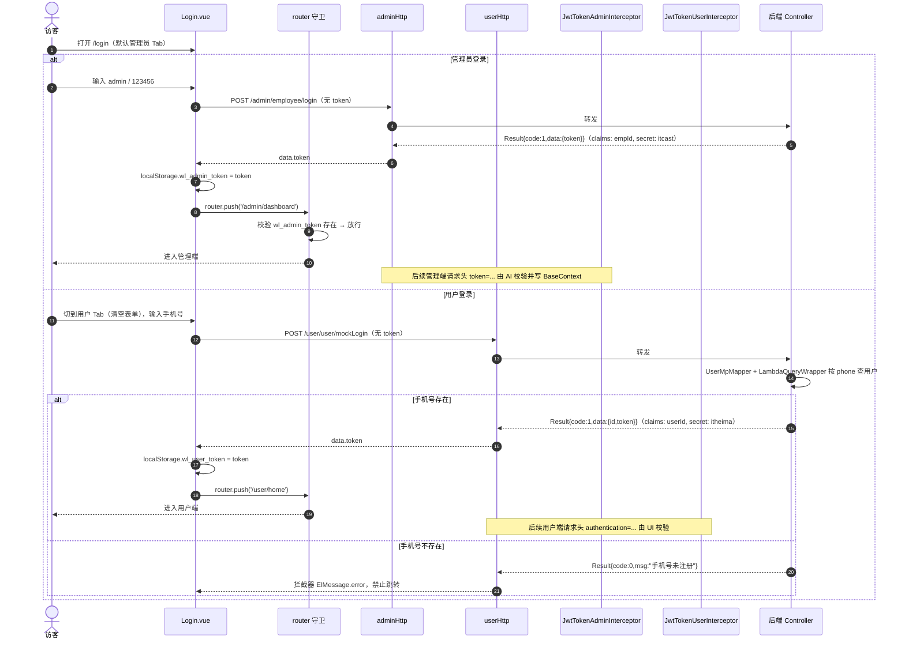
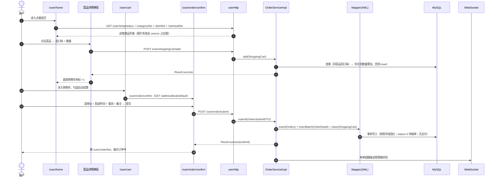
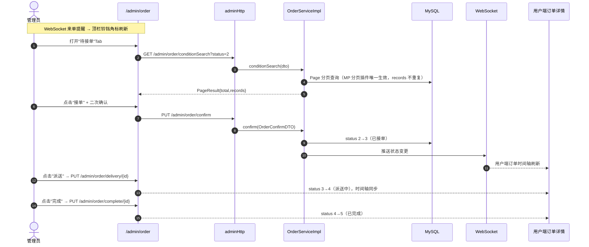
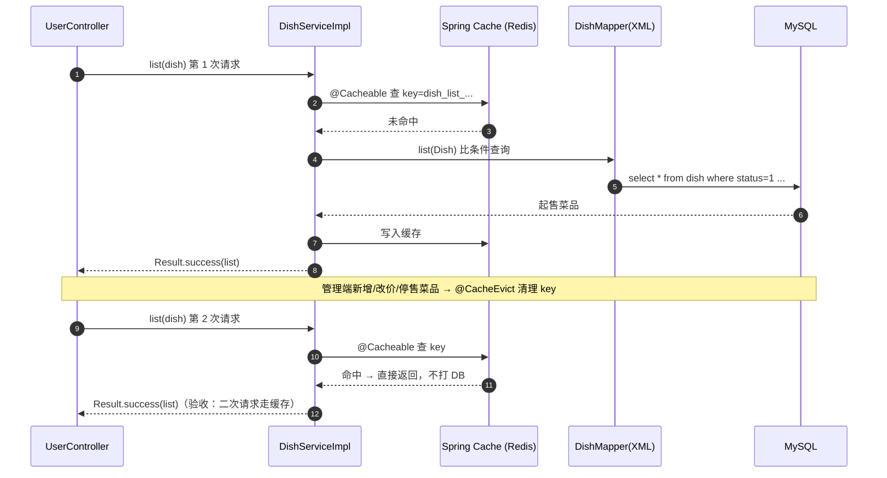
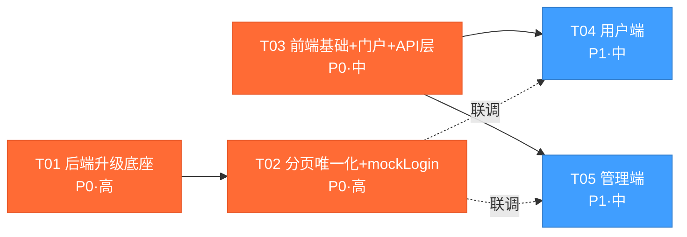

# 味来（Weilai）系统架构设计与任务分解 · v1.0

| 项目 | 内容 |
|------|------|
| 文档版本 | v1.0 |
| 架构师 | 高见远（Gao） |
| 上游输入 | 《味来-统一门户前端改造-PRD-v2.0.md》（许清楚，802 行） |
| 需求基准 | PRD v2.0 为**唯一**需求基准；后端现状工程 `D:\develop\cangQiongWaiMai\sky-take-out` 已做代码级核实 |
| 项目定位 | 中小厂实习简历项目：**浏览器可演示的闭环 + 主流技术栈 + 代码看得懂** |
| 硬约束 | ① 接口路径与 `Result{code,msg,data}` / `PageResult{total,records}` 风格严格不变 ② 能不改就不改 ③ 支付彻底排除 |

> **架构总原则（贯穿全文）**：把"能跑起来"的兼容改动做扎实，把"讲得清"的技术点留下，把"不必要"的重构全部砍掉。不引入微前端、不引入复杂状态管理、不引入多余中间件。每个技术选型都给出"为什么选 / 为什么不选更重的方案"。

---

## 〇、架构师核实结论：两个 PRD 未覆盖的致命坑（必须先读）

在设计之前我对现状工程做了**代码级编译验证**，发现两个会让 PRD 方案直接失败的问题。这两条是本架构设计的核心增量价值，工程师必须先看懂再动手。

### 坑 A：`extends BaseMapper<T>` 与现有 Mapper 方法签名冲突（编译期报错）

PRD 3.2 要求"各 Mapper 接口……额外 `extends BaseMapper<XxxEntity>`"。但现状 **8 个 Mapper 声明了 `void insert(Entity)`**，而 `BaseMapper<T>.insert(T)` 返回 `int`。Java 泛型的 erase 后两者签名相同、返回值不兼容 → **编译失败**。

我用最小样例实际编译验证：

```
// 现状 UserMapper
@Mapper public interface UserMapper { void insert(User user); ... }
// 若改成 extends BaseMapper<User>
@Mapper public interface UserMapper extends BaseMapper<User> { void insert(User user); }
// 编译结果：
// UserMapper 中的 insert(User) 与 BaseMapper 中的 insert(T) 冲突
//   两个方法的返回类型 void 与 int 不兼容
```

受影响方法统计（`insert(Entity)` 冲突；`deleteById(Long)` 属于**重载**，编译可通过）：

| Mapper | `insert(Entity)` | 是否可安全 extends BaseMapper |
|--------|------------------|------------------------------|
| UserMapper / EmployeeMapper / CategoryMapper / DishMapper / SetmealMapper / OrderMapper / AddressBookMapper / ShoppingCartMapper | `void insert(Xxx)` | ❌ 直接继承会编译失败 |
| DishFlavorMapper / OrderDetailMapper / SetmealDishMapper | 仅 `insertBatch(List<...>)` | ✅ 无签名冲突（但继承后无实际用途） |

**架构决策（写入 shared knowledge，工程师必须遵守）**：
> **不采用"全量 Mapper 继承 BaseMapper"的写法。** MyBatis-Plus 只从两个"窄口"接入：
> 1. **分页**：靠全局 `PaginationInnerInterceptor` + `Page` 入参，完全不需要 Mapper 继承 BaseMapper；
> 2. **LambdaQueryWrapper 新查询**（mockLogin 按 phone 查 user）：**新建一个隔离的空接口** `com.sky.mapper.mp.UserMpMapper extends BaseMapper<User>`，只给这一个接口加泛型能力，既有 11 个 Mapper 与 11 个 XML **一行不动**。
>
> 这样既拿到 MyBatis-Plus 的简历亮点，又守住"接口不变 / 能不改就不改 / 代码看得懂"。理由很直白：为了让 8 个 Mapper 多一个用不到的 `selectById`，去改 8 处签名 + 8 处 XML + 8 处 Service，收益为负、风险极高。

### 坑 B：JJWT 0.11.5+ 拒绝 `itcast` / `itheima` 这种短密钥（启动/登录即抛异常）

PRD 要求"secret 保持 itcast / itheima 不变"。但 JJWT 0.11.x 的 `Keys.hmacShaKeyFor()` 对 HS256 **强制要求密钥 ≥ 32 字节（256 bit）**，`itcast` 只有 6 字节、`itheima` 7 字节 → 抛 `WeakKeyException`。PRD 只提到"JDK17 无 JAXB 导致 0.9.1 启动失败"，没提到升级后短密钥同样不可用。

**架构决策**：保持**配置项** `itcast` / `itheima` 字面不变（所以前端与 `JwtProperties` 零改动），在 `JwtUtil` 内部用一个确定性函数把它派生为 32 字节密钥：

```java
// sky-common/.../JwtUtil.java —— 关键片段（工程师照此实现）
private static SecretKey keyOf(String secret) {
    byte[] raw = secret.getBytes(StandardCharsets.UTF_8);
    byte[] key32 = Arrays.copyOf(raw, 32);   // 不足 32 字节补 0；演示项目足够，且 create/parse 同源
    return Keys.hmacShaKeyFor(key32);         // 0.11.5: io.jsonwebtoken.security.Keys
}
// 签发
String jwt = Jwts.builder().claims(claims).expiration(exp)
                  .signWith(keyOf(secretKey), Jwts.SIG.HS256).compact();
// 解析
Claims claims = Jwts.parser().verifyWith(keyOf(secretKey)).build()
                     .parseSignedClaims(token).getPayload();
```

- **claims key（empId / userId）不变、header 名（token / authentication）不变、ttl 不变** → **前端零改动**这条硬约束依然成立。
- 唯一副作用：升级前已签发的旧 token 无法通过校验（密钥派生方式变了）。演示项目可接受——**升级后所有账号重新登录一次即可**。这一点写入交付话术与 QA 验收前置条件。

---

## 一、总体架构

### 1.1 前后端分离拓扑

```
┌──────────────────────────── 浏览器（单端口 Web 门户） ────────────────────────────┐
│                                                                                  │
│   ┌──────────────────────────────────────────────────────────────────────────┐  │
│   │  统一登录门户 /login   （默认管理员 Tab；切换即清空表单）                  │  │
│   │    ├─ 管理员：账号+密码 → 写 wl_admin_token      → /admin/dashboard        │  │
│   │    └─ 用  户：手机号   → 写 wl_user_token        → /user/home             │  │
│   └──────────────────────────────────────────────────────────────────────────┘  │
│                    ↓ 路由守卫（按 localStorage token 判定身份）                  │
│   ┌────────────────────────┐          ┌──────────────────────────────────────┐  │
│   │ 用户端 /user/**        │          │ 管理端 /admin/**                     │  │
│   │ 美观前台 · 暖橙主题     │          │ 传统后台 · Element Plus 蓝灰主题      │  │
│   │ 点餐/购物车/下单/订单   │          │ 工作台/订单/菜品/套餐/分类/报表        │  │
│   │ axios 实例：userHttp   │          │ axios 实例：adminHttp                │  │
│   │ header: authentication │          │ header: token                        │  │
│   └───────────┬────────────┘          └──────────────┬───────────────────────┘  │
└───────────────┼──────────────────────────────────────┼──────────────────────────┘
                │  Vite dev proxy /api → localhost:8080（生产同源部署）
                ▼                                      ▼
┌─────────────────────────── 后端 sky-server :8080 ────────────────────────────────┐
│  JwtTokenAdminInterceptor(/admin/**)   JwtTokenUserInterceptor(/user/**)         │
│  Controller → Service → Mapper → MySQL(weilai_take_out)                          │
│  AOP 公共字段填充 / Spring Cache(Redis) / WebSocket 来单提醒 / 定时任务 / OSS     │
└──────────────────────────────────────────────────────────────────────────────────┘
```

**关键边界**：前端是两个路由空间、**一个 Vue 应用、一次构建**；后端是**一个 SpringBoot 应用、一套 JWT 拦截器按 URL 前缀分流**，通过 `application-dev.yml` 的两组 jwt 配置（不同 secret / 不同 header 名 / 不同 claims key）实现"双身份隔离"。

### 1.2 技术选型表（含取舍理由）

| 层次 | 选型 | 版本建议 | 为什么选 / 为什么不选更重的 |
|------|------|----------|--------------------------|
| 后端 JDK | JDK 17 | 17 LTS | 用户指定；SpringBoot3 门槛。**不用 21**：新特性本项目用不到，反而增加兼容面 |
| 后端框架 | Spring Boot | **3.2.5**（稳态） | 用户指定；3.2.x 生态最稳、资料最多。**不用 3.3/3.4**：升级踩坑资料少，初学者排障难 |
| ORM | MyBatis-Plus | **3.5.5**（Boot3 兼容线） | 用户指定；分页插件 + Lambda 查询两个亮点。**不用 JPA**：会推翻全部 XML，违背"接口不变" |
| 数据库 | MySQL | 8.x | 沿用；DDL 列名/表名零改动 |
| 缓存 | Redis + Spring Cache | 沿用 | 只改配置前缀；菜品/套餐缓存是现成亮点，**不引入 Caffeine 多级缓存** |
| JWT | JJWT | **0.11.5** | 0.9.1 在 JDK17 因 JAXB 移除而启动失败；**不用 0.12.x**：0.12 包名/API 变动更大，资料少，0.11.5 足够且稳定 |
| API 文档 | SpringDoc OpenAPI 3 | **2.3.0** | Springfox/Knife4j 不兼容 Boot3；**只做注解替换**，不改接口行为 |
| 分页 | MP PaginationInnerInterceptor | 随 MP | **彻底移除 PageHelper**（两者并存会导致 total 对但 records 重复） |
| 公共字段填充 | **保留现有 AOP** | 沿用 | **不注册 MetaObjectHandler**，避免两套填充写同一字段导致覆盖 |
| 前端框架 | Vue 3 | 3.4.x | 用户指定；`<script setup>` 语法对初学者最友好 |
| 构建 | Vite | 5.x | 用户指定；冷启动秒级，比 Webpack  configuration 少 |
| UI 组件 | Element Plus | 2.x | 用户指定；管理端天然适配，用户端用 CSS 变量覆写主色 |
| HTTP | axios | 1.x | 用户指定；双实例封装是本项目鉴权核心 |
| 路由 | vue-router | 4.x | 用户指定；路由守卫实现身份分流 |
| 图表 | ECharts | 5.x | 仅管理端"数据统计/工作台"使用，**按需引入**避免全量打包 |
| 状态管理 | **不引入 Pinia（v1）** | — | 见 3.5 克制建议：跨页状态仅"当前用户 + 购物车数量"，`reactive` 单例 + localStorage 足够 |
| 微前端 | **不引入** | — | 单应用双路由空间已满足"一个网址体验双端"，qiankun 只会增加构建与联调成本 |

### 1.3 后端三模块职责边界（现状已核实，升级中保持不变）

| 模块 | 职责 | 升级改动量 | 边界规则 |
|------|------|-----------|----------|
| `sky-common` | 跨模块基础设施：`Result` / `PageResult`、常量、上下文 `BaseContext`、`JwtUtil`、`JwtProperties`、异常类、`AliOssUtil` | **中**：`JwtUtil` 重写（坑 B）；`JwtProperties`/`Result`/`PageResult`/`BaseContext`/异常类**零改动** | 不依赖 `sky-pojo` 业务类；不引入 Spring Web 之外的新依赖 |
| `sky-pojo` | 纯数据载体：`entity` / `dto` / `vo` | **零改动** | 不在这里加 MP 注解（尤其 `@Version` / `@TableLogic`），避免污染既有 DDL 兼容 |
| `sky-server` | 业务主体：`controller` / `service` / `mapper` / `interceptor` / `config` / `aspect` / `task` / `websocket` / `handler` | **高**：全部升级改动集中在此 | Controller 方法签名与 URL 一律不动；Mapper XML 主体 SQL 不动 |

**红线**：`Result` / `PageResult` / `JwtClaimsConstant` / `JwtProperties` / 所有 DTO·VO 字段 / 所有 Controller URL —— 这些文件在升级中**不允许出现 diff**（QA 会据此验收）。

---

## 二、后端升级方案

### 2.1 六个高危点：逐条对策 + 执行顺序

> 执行顺序原则：**先让工程"能编译"，再让功能"能跑对"，最后做"看得见"的增量**。每一步都有可验证的关卡，不要一次性改完再编译。

#### ① javax → jakarta 全量迁移（中高危，但**实际范围很小**）

**核实结论**：全工程 `javax.` 仅 **6 个文件、14 行**（比 PRD 担心的范围小得多，因为项目本来就没用 `@Resource` / validation 注解）：

| 文件 | 迁移内容 |
|------|---------|
| `interceptor/JwtTokenAdminInterceptor.java` | `javax.servlet.http.HttpServletRequest/Response` → `jakarta.servlet.http.*` |
| `interceptor/JwtTokenUserInterceptor.java` | 同上 |
| `controller/admin/ReportController.java` | `javax.servlet.http.HttpServletResponse` → `jakarta.*` |
| `service/ReportService.java` | `javax.servlet.http.HttpServletResponse` → `jakarta.*` |
| `service/impl/ReportServiceImpl.java` | `javax.servlet.ServletOutputStream` + `HttpServletResponse` → `jakarta.*` |
| `websocket/WebSocketServer.java` | `javax.websocket.*`（6 个注解/Session/PathParam）→ `jakarta.websocket.*` |

**对策**：全局搜索 `javax.` 逐个替换；`pom.xml` 增加 `spring-boot-starter-validation`（防御性，未来 DTO 加校验注解时不再踩坑）。`WebSocketServer` 的 `jakarta.websocket` 由 `spring-boot-starter-websocket` 传递提供，无需额外依赖。

#### ② JWT 升级（最高危，含坑 B）

**对策（执行顺序）**：
1. 父 `pom.xml`：移除 `io.jsonwebtoken:jjwt:0.9.1` 与 `javax.xml.bind:jaxb-api`；新增 `jjwt-api` / `jjwt-impl`(runtime) / `jjwt-jackson`(runtime)，版本 `0.11.5`。
2. 按〇章坑 B 的 `keyOf()` 方案重写 `JwtUtil.createJWT` / `parseJWT`。
3. **保持 4 项不变**：`application.yml` 中 `admin-secret-key=itcast` / `user-secret-key=itheima` / `admin-token-name=token` / `user-token-name=authentication` / 两个 ttl / `JwtClaimsConstant.EMP_ID=empId`、`USER_ID=userId`。
4. 两个拦截器**只改 import**（`javax`→`jakarta`），业务逻辑（取 header → 解析 → `BaseContext.setCurrentId` → 401）一行不动。
5. 关卡：分别用管理员与用户身份登录，确认两个请求头都被正确读取；旧 token 失效属预期。

#### ③ MyBatis-Plus 与 XML 共存（最高危，含坑 A）

**对策（严格执行〇章坑 A 的窄口方案）**：

`application.yml` 配置变更（这是唯一需要改的配置段）：

```yaml
spring:
  data:                      # 由 spring.redis.* 迁移而来（Boot 3.2 新前缀）
    redis:
      host: ${sky.redis.host}
      port: ${sky.redis.port}
      password: ${sky.redis.password}
      database: ${sky.redis.database}

mybatis-plus:                # 由 mybatis.* 迁移而来
  mapper-locations: classpath:mapper/*.xml     # 保持原值，11 个 XML 原样加载
  type-aliases-package: com.sky.entity          # 别名不变，XML 里的 resultType 才能继续解析
  configuration:
    map-underscore-to-camel-case: true          # 下划线列 ↔ camelCase 实体，DDL 零改动的关键
  global-config:
    db-config:
      id-type: auto                             # ★ 必须 auto，禁用 MP 默认雪花 ID
      # ★★ 不配置 logic-delete-field —— 原库无 deleted 列，开启会给所有 SQL 追加 WHERE deleted=0 直接报错
# ★★★ 不注册 MetaObjectHandler —— 保留现有 AOP 填充，避免 createTime/updateTime 被双写覆盖
```

**MybatisPlusConfig（新增，全工程唯一的分页插件）**：

```java
@Configuration
public class MybatisPlusConfig {
    @Bean
    public MybatisPlusInterceptor mybatisPlusInterceptor() {
        MybatisPlusInterceptor interceptor = new MybatisPlusInterceptor();
        interceptor.addInnerInterceptor(new PaginationInnerInterceptor(DbType.MYSQL));
        return interceptor;
    }
}
```

**11 个 Mapper 接口**：**保持现状，不加 `extends BaseMapper`**（坑 A）。仅新增 `com.sky.mapper.mp.UserMpMapper extends BaseMapper<User>` 供 mockLogin 的 LambdaQueryWrapper 使用。

**分页改造的 6 个调用点**（`PageHelper.startPage` 已定位）：`CategoryServiceImpl:65`、`DishServiceImpl:70`、`EmployeeServiceImpl:96`、`SetmealServiceImpl:72`、`OrderServiceImpl:133`、`OrderServiceImpl:260`。改造模板：

```java
// 改前（PageHelper）
PageHelper.startPage(dto.getPage(), dto.getPageSize());
Page<Category> page = categoryMapper.pageQuery(dto);      // com.github.pagehelper.Page
return new PageResult(page.getTotal(), page.getResult());

// 改后（MyBatis-Plus）
Page<Category> page = new Page<>(dto.getPage(), dto.getPageSize());  // com.baomidou...Page
categoryMapper.pageQuery(page, dto);
return new PageResult(page.getTotal(), page.getRecords());  // ★ PageResult 组装逻辑不变，只换 getResult→getRecords
```

Mapper 与 XML 的**最小改动**（仅 5 个 `pageQuery`，其余 CRUD 的 XML 全不动）：

```java
// Mapper：新增 Page 入参，DTO 加 @Param 别名
Page<Category> pageQuery(@Param("page") Page<Category> page,
                         @Param("dto") CategoryPageQueryDTO dto);
```
```xml
<!-- XML：仅把分页 select 内的字段引用加 dto. 前缀，SQL 逻辑/条件/排序一行不动 -->
<select id="pageQuery" resultType="com.sky.entity.Category">
    select * from category
    <where>
        <if test="dto.name != null and dto.name != ''">and name like concat('%',#{dto.name},'%')</if>
        <if test="dto.type != null">and type = #{dto.type}</if>
    </where>
    order by sort asc, create_time desc
</select>
```

> 说明：PRD 说"XML 零改动"，严格零改动在分页上是做不到的（MP 需要把 `Page` 作为入参）。我把改动压缩到**每个分页 select 内 2~6 处 `#{字段}` → `#{dto.字段}` 的机械前缀**，SQL 语义、表、列、条件、排序完全不变。这是"能不改就不改"与"分页必须换"之间的最小交集，且对初学者最容易讲清楚。

**XML 冒烟清单**（工程师改造完成后逐条打勾，QA 复核）：

| # | XML 文件 | 冒烟检查项 | 通过标准 |
|---|---------|-----------|---------|
| 1 | `EmployeeMapper.xml` | `resultType`/`parameterType` 别名解析；`selectByUsername` 登录查询 | 管理员 `admin/123456` 登录成功 |
| 2 | `UserMapper.xml` | `insert` 的 `useGeneratedKeys/keyProperty=id`；`countByMap` 的 `<where>` 动态条件 | 微信登录插入用户拿到自增 id；报表用户数正确 |
| 3 | `CategoryMapper.xml` | `pageQuery` 加 `dto.` 前缀后 `#{dto.name}`/`#{dto.type}` 生效；`list` 未受影响 | 分类分页 total 准确、records 不重复；用户端分类列表正常 |
| 4 | `DishMapper.xml` | `pageQuery` 前缀；`list`、`getByDishId`；`<foreach>` 集合参数名（`dishIds`） | 菜品分页无重复；用户端菜品列表过滤起售；批量删除成功 |
| 5 | `DishFlavorMapper.xml` | `insertBatch` 的 `<foreach collection="flavors">` | 新增菜品带口味成功 |
| 6 | `SetmealMapper.xml` | `pageQuery` 前缀；`getDishItemBySetmealId` 多表联查 | 套餐分页与用户端套餐详情正常 |
| 7 | `SetmealDishMapper.xml` | `insertBatch` 的 `<foreach>`；`deleteBySetmealIds` | 新建套餐关联菜品成功 |
| 8 | `OrderMapper.xml` | `pageQuery` 前缀；`countStatus`/`sumByMap`/`getByStatusAndOrderTimeLT` 动态 SQL | 订单分页、工作台统计、超时自动取消正常 |
| 9 | `OrderDetailMapper.xml` | `insertBatch` 的 `<foreach>`；`getTop10ByMap` 别名 `GoodsSalesDTO` | 下单明细落库；销量 Top10 报表正确 |
| 10 | `ShoppingCareMapper.xml`（注意历史拼写） | `list`/`sub` 的 `dishId`/`setmealId` 空值判断 | 购物车增删、清空、数量增减正常 |
| 11 | `AddressBookMapper.xml` | `updateIsDefaultByUserId` 与 `list` | 地址默认标记、用户端地址列表正常 |
| 通用 | 全部 11 个 | `id-type:auto` 下新增记录主键为数据库自增（非雪花长串）；AOP 仍填充 createTime/updateTime | 新增任意记录后查库核对 id 与四个公共字段 |

#### ④ 分页唯一化（最高危）

**对策**：父 pom 与 server pom **同时移除** `pagehelper-spring-boot-starter`（仅在父 pom 的 dependencyManagement 移除还不够，server 的直接依赖必须删干净）；全工程 `grep PageHelper` 结果必须为 **0**；只保留 `MybatisPlusConfig` 中唯一的 `PaginationInnerInterceptor(DbType.MYSQL)`。

**验收**：连续请求 `/admin/dish/page` 3 次，`PageResult.total` 准确且 `records` 无重复 ID（对应 PRD 验收 D3）。

#### ⑤ SpringDoc 替换 Springfox/Knife4j（中）

**核实结论**：Springfox 引用集中在 `WebMvcConfiguration.java`（2 个 `Docket` Bean + springfox import + `/doc.html` 静态映射），Swagger 注解散布在 **19 个文件**（约 90 处 `@Api`/`@ApiOperation`/`@ApiModel`/`@ApiModelProperty`）。

**对策**：
1. pom：移除 `knife4j-spring-boot-starter`；新增 `springdoc-openapi-starter-webmvc-ui:2.3.0`。
2. `WebMvcConfiguration`：删除两个 `Docket` Bean 与 `/doc.html`、`/webjars/**` 映射；替换为：

```java
@Bean
public OpenAPI weilaiOpenAPI() {
    return new OpenAPI().info(new Info().title("味来 Weilai 接口文档").version("2.0"));
}
@Bean
public GroupedOpenApi adminApi() {
    return GroupedOpenApi.builder().group("管理端接口")
           .packagesToScan("com.sky.controller.admin").build();
}
@Bean
public GroupedOpenApi userApi() {
    return GroupedOpenApi.builder().group("用户端接口")
           .packagesToScan("com.sky.controller.user").build();
}
```
3. 注解批量替换（**仅注解层，零接口行为影响**）：`@Api(tags=)`→`@Tag(name=)`；`@ApiOperation(value=)`→`@Operation(summary=)`；`@ApiModel`→`@Schema`；`@ApiModelProperty(value=)`→`@Schema(description=)`；import 由 `io.swagger.annotations.*` → `io.swagger.v3.oas.annotations.*`。
4. 文档地址改为 `/swagger-ui/index.html`；旧 `/doc.html` 弃用。

#### ⑥ Spring Cache 配置适配（中）

**对策**：`spring.redis.*` → `spring.data.redis.*`（见 2.1③ 配置段）；`RedisConfiguration`、`@EnableCaching`、`@Cacheable`/`@CacheEvict`、`DishServiceImpl`/`SetmealServiceImpl` 的缓存逻辑**一行不动**。启动后实测 `/user/dish/list` 连续两次请求，第二次走缓存（看 Redis key 命中与日志），对应 PRD RK-11。

### 2.2 pom.xml 依赖变更清单

**根 `pom.xml`（父）**：

| 动作 | 坐标 | 说明 |
|------|------|------|
| 改 | `spring-boot-starter-parent` `2.7.3` → **`3.2.5`** | 升级主版本 |
| 增 | properties `<java.version>17</java.version>` | JDK 17 |
| 改 | `mybatis-spring-boot-starter` → **`mybatis-plus-boot-starter:3.5.5`** | 用 MP starter 坐标 |
| 删 | `pagehelper-spring-boot-starter` | 分页唯一化 |
| 删 | `knife4j-spring-boot-starter` | 换 SpringDoc |
| 删 | `javax.xml.bind:jaxb-api` | JDK17 + 新 JJWT 不再需要 |
| 删 | `io.jsonwebtoken:jjwt:0.9.1` | 换三件套 |
| 增 | `jjwt-api` / `jjwt-impl` / `jjwt-jackson` `0.11.5` | 后两个 scope=runtime |
| 增 | `springdoc-openapi-starter-webmvc-ui:2.3.0` | API 文档 |
| 增 | `spring-boot-starter-validation` | 校验注解防御（Boot3 不再默认传递） |
| 保留 | `fastjson` / `druid-spring-boot-starter` / `aspectjrt` / `aspectjweaver` / `aliyun-sdk-oss` / `poi` / `poi-ooxml` / lombok | 能不改就不改 |

> **支付排除**：父 pom 中现存的 `wechatpay-apache-httpclient` 与 `sky-common/utils/WeChatPayUtil.java` 是历史遗留，**本轮不调用、不新增、不删除**（删除会引发无关改动）。前端不出现任何支付入口，QA 按 D4 检索确认即可。

**`sky-server/pom.xml`**：删除 `pagehelper-spring-boot-starter` 直接依赖、`knife4j-spring-boot-starter`、`jaxb-api`；`mybatis-spring-boot-starter` → `mybatis-plus-boot-starter`；新增上述 jjwt 三件套 / springdoc / validation。`sky-common`、`sky-pojo` 的 pom 除父版本继承外**无变更**。

### 2.3 数据库迁移脚本策略

PRD 4.4 的 DDL 列名/表名与原库完全一致，这是"Mapper XML 零改动"的地基。策略如下：

1. **交付展示库**：新建 `weilai_take_out`，执行 PRD 4.4 DDL（11 表、utf8mb4、索引齐全），作为"全新数据库设计"的简历证据与干净演示环境。
2. **开发联调**：`application-dev.yml` 的 `sky.datasource.database` 可继续指向已有数据的 `sky_take_out`（里面已有演示数据）；两库表结构兼容，切换只改这一行。**不要在数据未迁移前强行切库**，否则演示时全空。
3. **数据迁移（可选）**：若要用新库演示，用 `mysqldump sky_take_out | sed 's/sky_take_out/weilai_take_out/' | mysql -uroot -p <库>` 快速克隆表+数据，再补执行索引 ALTER。
4. **索引增量**：若沿用旧库且想拿到 4.5 的索引优化亮点，对旧库执行增量 `ALTER TABLE ... ADD UNIQUE/INDEX ...`（PRD 4.5 表已列出）；索引不影响功能，缺失也能跑通。
5. **可选列**：`address_book.create_time/update_time` 为新增可选列，实体不补、XML 不引用 → **不影响接口**，仅在用全新 DDL 建库时存在。
6. **不做**：逻辑删除列（`is_deleted`）、乐观锁列（`version`）本轮**不落库、不接入**（PRD 4.5 明确暂缓），避免 MP 全局策略误伤既有 SQL。

---

## 三、前端架构

### 3.1 目录结构（Vue3 + Vite，单应用双身份）

```
weilai-web/
├── index.html
├── package.json
├── vite.config.js                  # /api 代理到 localhost:8080
├── src/
│   ├── main.js                     # createApp + ElementPlus + router mount
│   ├── App.vue                     # <router-view/>
│   ├── router/
│   │   └── index.js                # 路由表 + 全局前置守卫（身份分流）
│   ├── api/
│   │   ├── request.js              # ★ 双 axios 实例 + Result 拦截器
│   │   ├── admin/                  # 管理端接口（header: token）
│   │   │   ├── employee.js  category.js  dish.js  setmeal.js
│   │   │   ├── order.js     report.js    workspace.js  common.js
│   │   └── user/                   # 用户端接口（header: authentication）
│   │       ├── auth.js      shop.js      category.js  dish.js
│   │       ├── setmeal.js   cart.js      address.js   order.js
│   ├── store/
│   │   └── session.js              # reactive 单例：身份 + 用户信息 + 购物车数量
│   ├── utils/
│   │   └── auth.js                 # token 读写 localStorage / 清理 / 身份判定
│   ├── styles/
│   │   ├── theme.css               # CSS 变量：暖橙主色 + Element Plus 覆写
│   │   └── admin.css               # 后台紧凑表格样式
│   ├── assets/
│   │   └── placeholder-food.png    # ★ 图片兜底图（RK-02）
│   ├── layout/
│   │   ├── UserLayout.vue          # 顶栏64 + 分类栏160 + 悬浮购物车栏
│   │   └── AdminLayout.vue         # 侧栏200深蓝灰 + 顶栏56 + 面包屑
│   ├── views/
│   │   ├── Login.vue               # 统一门户（身份 Tab 切换）
│   │   ├── user/  Home.vue  DishDialog.vue  Cart.vue  OrderConfirm.vue
│   │   │          OrderList.vue  OrderDetail.vue  Address.vue
│   │   └── admin/ Dashboard.vue  Order.vue  Dish.vue  Setmeal.vue
│   │              Category.vue  Report.vue
│   └── websocket/
│       └── index.js                # 管理端来单/催单铃铛（轻量封装）
```

### 3.2 路由表与守卫

| 路由 | 身份 | 组件 | 守卫规则 |
|------|------|------|---------|
| `/` | 公开 | — | 重定向：按 token 到 `/admin/dashboard` 或 `/user/home`，否则 `/login` |
| `/login` | 公开 | `Login.vue` | 已登录按对应 token 直接跳首页 |
| `/admin/dashboard` | 管理员 | `Dashboard.vue` | 无 `wl_admin_token` → `/login` |
| `/admin/order` | 管理员 | `Order.vue` | 同上 |
| `/admin/dish` / `/admin/setmeal` / `/admin/category` / `/admin/report` | 管理员 | 对应页面 | 同上 |
| `/user/home` | 用户 | `Home.vue` | 无 `wl_user_token` → `/login` |
| `/user/cart` / `/user/order/confirm` / `/user/order/list` / `/user/order/:id` / `/user/address` | 用户 | 对应页面 | 同上 |

**守卫伪码**（router/index.js）：

```js
router.beforeEach((to, from, next) => {
  const adminToken = localStorage.getItem('wl_admin_token')
  const userToken  = localStorage.getItem('wl_user_token')
  if (to.path.startsWith('/admin') && !adminToken) return next('/login')
  if (to.path.startsWith('/user')  && !userToken)  return next('/login')
  if (to.path === '/login') {
    if (adminToken) return next('/admin/dashboard')
    if (userToken)  return next('/user/home')
  }
  next()
})
```

**越权防线**：路由守卫（前端体验层）+ 后端两套拦截器（真正的安全层）。用户端代码**禁止**出现任何 `/admin/**` 调用；管理端**禁止**调用 `mockLogin`（PRD 5.4）。

### 3.3 API 层分组与 axios 双实例

`src/api/request.js` —— 全项目鉴权与响应处理的中枢：

```js
import axios from 'axios'
import { ElMessage } from 'element-plus'
import router from '@/router'

function makeInstance(tokenKey, headerName) {
  const ins = axios.create({ baseURL: '/api', timeout: 15000 })
  ins.interceptors.request.use(cfg => {
    const t = localStorage.getItem(tokenKey)
    if (t) cfg.headers[headerName] = t          // ★ 管理员=token，用户=authentication
    return cfg
  })
  ins.interceptors.response.use(res => {
    const body = res.data                        // Result{code,msg,data}
    if (body && body.code === 1) return body.data // ★ 成功直接返回 data，业务层少一层解包
    ElMessage.error(body?.msg || '请求失败')
    return Promise.reject(body)
  }, err => {
    if (err.response?.status === 401) {
      localStorage.removeItem(tokenKey)
      router.push('/login')
    }
    ElMessage.error('登录已过期，请重新登录')
    return Promise.reject(err)
  })
  return ins
}

export const adminHttp = makeInstance('wl_admin_token', 'token')
export const userHttp  = makeInstance('wl_user_token',  'authentication')
```

**接口分组规则**：每个业务模块一个 js 文件，函数命名 = 动作 + 资源（如 `pageDish`、`addCart`、`confirmOrder`），URL 严格照 PRD 附录 A，**不出现任何 payment/支付 字样**。分页参数统一 `{page, pageSize}`，后端返回 `{total, records}` 直接交给 `el-pagination`。

### 3.4 统一门户鉴权流时序图



### 3.5 状态管理：克制建议（**v1 不引入 Pinia**）

**现状**：跨组件共享状态只有两类——① 当前身份/用户信息；② 购物车数量角标。

**建议**：用 `src/store/session.js` 一个 `reactive` 单例 + localStorage 持久化即可，20 行代码解决：

```js
import { reactive } from 'vue'
export const session = reactive({
  role: localStorage.getItem('wl_admin_token') ? 'admin'
      : localStorage.getItem('wl_user_token') ? 'user' : null,
  cartCount: 0,
  setRole(role) { this.role = role },
  logout() {
    localStorage.removeItem('wl_admin_token')
    localStorage.removeItem('wl_user_token')
    this.role = null; this.cartCount = 0
  }
})
```

**理由**：Pinia 会引入 store / actions / getters / 持久化插件等一整套概念，对 Java 入门者是多一层认知负担，而本项目状态量极小。**什么时候再上 Pinia**：若购物车需要在 5+ 页面双向同步且出现复杂派生状态（如优惠计算）——那是 v2 的事。ECharts 同理，**只在报表/工作台组件内 `import * as echarts` 按需引入**，不做全局注册。

---

## 四、数据结构与接口（核心类图）

> **契约声明**：以下 DTO / VO / Entity 的**字段签名、Controller 方法签名、URL 在升级前后完全一致**。`Result` / `PageResult` 结构零改动。类图中标注 `【不变】` 的部分 QA 将做 diff 校验。

```mermaid
classDiagram
    class Result~T~ {
        -Integer code
        -String msg
        -T data
        +success() Result~T~
        +success(T object) Result~T~
        +error(String msg) Result~T~
    }
    note for Result "【不变】code=1成功/0失败，全端统一"

    class PageResult {
        -long total
        -List records
    }
    note for PageResult "【不变】Controller 组装逻辑禁改；getResult→getRecords 仅内部换源"

    class JwtProperties {
        -String adminSecretKey
        -Long adminTtl
        -String adminTokenName
        -String userSecretKey
        -Long userTtl
        -String userTokenName
    }
    note for JwtProperties "【不变】itcast/itheima；token/authentication；两个ttl"

    class JwtUtil {
        +createJWT(String secret, long ttl, Map claims) String
        +parseJWT(String secret, String token) Claims
        -keyOf(String secret) SecretKey
    }
    note for JwtUtil "【重写】API 换 0.11.5；内部 keyOf 补 32 字节；claims 契约不变"

    class BaseContext {
        -ThreadLocal~Long~ CURRENT_ID
        +setCurrentId(Long id) void
        +getCurrentId() Long
        +remove() void
    }
    note for BaseContext "【不变】ThreadLocal 隔离，拦截器写入"

    class JwtTokenAdminInterceptor {
        -JwtProperties jwtProperties
        +preHandle(req, resp, handler) boolean
    }
    class JwtTokenUserInterceptor {
        -JwtProperties jwtProperties
        +preHandle(req, resp, handler) boolean
    }
    note for JwtTokenAdminInterceptor "【仅改import】javax→jakarta；header=token；claims=empId"
    note for JwtTokenUserInterceptor "【仅改import】javax→jakarta；header=authentication；claims=userId"

    class AutoFileAspect {
        +autoFill(JoinPoint jp) void
    }
    class AutoFIll {
        <<annotation>>
        -OperationType value
    }
    note for AutoFileAspect "【不变】保留 AOP 填充；不注册 MetaObjectHandler"

    class Entity {
        <<interface>>
    }
    class Employee
    class User
    class Dish
    class Setmeal
    class Orders
    class AddressBook
    Entity <|.. Employee
    Entity <|.. User
    Entity <|.. Dish
    Entity <|.. Setmeal
    Entity <|.. Orders
    Entity <|.. AddressBook
    note for Entity "【不变】entity/dto/vo 全部字段不动；DDL 列名沿用原库"

    class UserMpMapper {
        <<interface>>
    }
    note for UserMpMapper "【新增】extends BaseMapper<User>，仅 mockLogin 用 LambdaQueryWrapper"

    class Mapper {
        <<interface>>
    }
    note for Mapper "【不变】11个既有 Mapper 不加 extends BaseMapper（坑A）；XML 仅分页加 dto. 前缀"

    class BaseMapper~T~ {
        <<interface>>
        +selectList(Wrapper) List~T~
        +insert(T) int
    }
    UserMpMapper --|> BaseMapper

    class MybatisPlusConfig {
        +mybatisPlusInterceptor() MybatisPlusInterceptor
    }
    note for MybatisPlusConfig "【新增】唯一分页插件 PaginationInnerInterceptor(MYSQL)"

    class Controller {
        <<interface>>
    }
    class Service
    class JwtUtilJ -> JwtUtil : 签发/校验
    Controller --> Service : 调用
    Service --> Mapper : 持久化
    Service --> JwtUtil : 登录签发
    Service --> AutoFileAspect : AOP 织入公共字段
    JwtTokenAdminInterceptor --> BaseContext : 写 empId
    JwtTokenUserInterceptor --> BaseContext : 写 userId
    MybatisPlusConfig ..> Mapper : 分页拦截
    Result <.. Controller : 统一封装
    PageResult <.. Controller : 分页封装
```

**关键接口签名保持不变（示例，工程师不得修改）**：

```java
// Result 封装
Result.success(data) / Result.error(msg)           // code=1 / code=0
// 分页
PageResult(long total, List records)
// 登录
POST /admin/employee/login  → Result<EmployeeLoginVO>{id,username,name,token}
POST /user/user/mockLogin   → Result<UserLoginVO>{id,openid,token}   ★本轮实现
// 支付相关接口：无，且明确不新增
```

---

## 五、程序调用流程（关键链路时序图）

### 5.1 用户下单（用户端）



**要点**：下单后订单**直接进 status=2「待接单」**，`pay_method`/`pay_status` 不产生真实支付链路（PRD 硬约束③）；订单快照（name/price/address）在提交时固化。

### 5.2 管理端接单（含状态同步）



### 5.3 缓存读写（菜品列表，验证 RK-11）



> **注意**：Boot3 迁移后 `spring.data.redis.*` 前缀生效，缓存命中才成立；`@EnableCaching`、`RedisConfiguration`、缓存注解均**不改**。

---

## 六、文件清单（按分组，相对路径）

### 6.1 后端升级（改配置/依赖/兼容）

| 文件 | 动作 | 要点 |
|------|------|------|
| `pom.xml`（根） | 改 | 父版本 3.2.5、java.version、依赖增删（2.2 清单） |
| `sky-server/pom.xml` | 改 | 删 PageHelper/Knife4j/jaxb，加 MP/JJWT/SpringDoc/validation |
| `sky-server/src/main/resources/application.yml` | 改 | `spring.data.redis.*`、`mybatis-plus.*`、id-type:auto；**jwt 段不动** |
| `sky-server/.../config/MybatisPlusConfig.java` | **新增** | 唯一分页插件 |
| `sky-server/.../config/WebMvcConfiguration.java` | 改 | javax→jakarta；Springfox Docket → SpringDoc OpenAPI/GroupedOpenApi；**拦截器注册保留并补 mockLogin 排除** |
| `sky-server/.../config/RedisConfiguration.java` | 不动 | 仅配置前缀随 yml 变化 |
| `sky-server/.../interceptor/JwtTokenAdminInterceptor.java` | 改 | 仅 import javax→jakarta |
| `sky-server/.../interceptor/JwtTokenUserInterceptor.java` | 改 | 仅 import javax→jakarta |
| `sky-server/.../websocket/WebSocketServer.java` | 改 | javax.websocket→jakarta.websocket |
| `sky-server/.../controller/admin/ReportController.java` | 改 | 仅 import javax→jakarta |
| `sky-server/.../service/ReportService.java` | 改 | 仅 import javax→jakarta |
| `sky-server/.../service/impl/ReportServiceImpl.java` | 改 | 仅 import javax→jakarta |
| `sky-common/.../utils/JwtUtil.java` | **重写** | 0.11.5 API + keyOf（坑 B） |
| 19 个 Controller / DTO / VO（含 `@Api*`） | 改 | 注解替换（SpringDoc），import 换包 |

### 6.2 后端增量（分页 + mockLogin）

| 文件 | 动作 | 要点 |
|------|------|------|
| `sky-server/.../service/impl/{Category,Dish,Employee,Setmeal,Order}ServiceImpl.java` | 改 | 6 处 PageHelper→MP Page；getResult→getRecords |
| `sky-server/.../mapper/{Category,Dish,Employee,Setmeal,Order}Mapper.java` | 改 | 5 个 pageQuery 加 `Page` 入参 + `@Param("dto")`；**不加 extends BaseMapper** |
| `sky-server/.../resources/mapper/{Category,Dish,Employee,Setmeal,Order}Mapper.xml` | 改 | 5 个分页 select 加 `dto.` 前缀（冒烟清单 #3/#4/#6/#1/#8） |
| `sky-server/.../mapper/mp/UserMpMapper.java`（新包） | **新增** | `extends BaseMapper<User>`，供 LambdaQueryWrapper |
| `sky-server/.../controller/user/UserController.java` | 改 | 新增 `POST /mockLogin`（`@Profile("dev")` 隔离，见下） |
| `sky-server/.../service/UserService.java` + `impl/UserServiceImpl.java` | 改 | `mockLogin(phone)`：查库→空则 `Result.error`/异常，非空签 JWT |
| `sky-server/.../config/WebMvcConfiguration.java` | 改 | user 拦截器 `excludePathPatterns` 补 `/user/user/mockLogin` |
| `sky-pojo/.../dto/MockLoginDTO.java` | **新增** | 单字段 `phone`（Web 登录入参） |
| `docs/sql/weilai_take_out_ddl.sql` | **新增** | PRD 4.4 DDL 落盘，便于一键建库 |

> **mockLogin 隔离**：用独立方法 + `@Profile("dev")`（在 `application-dev.yml` 生效）。若 `@Profile` 加在 Controller 方法上不生效，改用 `@Profile("dev")` 标注一个独立的 `MockLoginController`（URL 同为 `/user/user/mockLogin`），保证 prod profile 下不暴露。二选一由工程师实测决定，默认先试方法级。

### 6.3 前端门户（公共基础）

`weilai-web/` 下：`package.json`、`vite.config.js`、`index.html`、`src/main.js`、`src/App.vue`、`src/router/index.js`、`src/api/request.js`、`src/utils/auth.js`、`src/store/session.js`、`src/styles/theme.css`、`src/views/Login.vue`、`src/assets/placeholder-food.png`。

### 6.4 前端用户端（美观优先）

`src/layout/UserLayout.vue`；`src/views/user/` 下 `Home.vue`、`DishDialog.vue`、`Cart.vue`、`OrderConfirm.vue`、`OrderList.vue`、`OrderDetail.vue`、`Address.vue`；`src/api/user/` 下 8 个接口模块。

### 6.5 前端管理端（传统后台）

`src/layout/AdminLayout.vue`；`src/views/admin/` 下 `Dashboard.vue`、`Order.vue`、`Dish.vue`、`Setmeal.vue`、`Category.vue`、`Report.vue`；`src/api/admin/` 下 8 个接口模块；`src/websocket/index.js`；`src/styles/admin.css`。

### 6.6 文档

`docs/味来-系统架构设计与任务分解-v1.0.md`（本文）、`docs/class-diagram.mermaid`、`docs/sequence-diagram.mermaid`。

---

## 七、任务列表（核心，按依赖顺序）

> **5 个任务**；T01 与 T03 可从第 1 天起**并行**（前后端靠本文件的接口契约解耦）；T02 依赖 T01；T04/T05 依赖 T03 且彼此**并行**。工程师可按任务批量实现。

### T01 · 后端升级底座（编译关卡）— P0 · 复杂度：高

- **涉及文件**：根 `pom.xml`、`sky-server/pom.xml`、`application.yml`、`MybatisPlusConfig.java`(新)、`WebMvcConfiguration.java`、2 个拦截器、`WebSocketServer.java`、`ReportController.java`、`ReportService.java`、`ReportServiceImpl.java`、`JwtUtil.java`、19 个注解文件。
- **前置依赖**：无（可立即开工，与 T03 并行）。
- **执行要点**：① 先改 pom + yml，`mvn clean compile` 暴露全部编译错误；② javax→jakarta 逐个改；③ 按坑 B 重写 JwtUtil；④ Springfox→SpringDoc（配置 + 注解批量）；⑤ 确认 `grep -rn "javax\.\|PageHelper\|springfox" ` 均为 0。
- **验收点**：`mvn clean compile` 与 `mvn spring-boot:run` 均成功，**无 JAXB / javax / Swagger 冲突报错**（PRD D1）；`/swagger-ui/index.html` 可访问且分两组；管理员登录成功。
- **并行性**：与 T03 完全并行。

### T02 · 后端分页唯一化 + mockLogin 增量 — P0 · 复杂度：高

- **涉及文件**：5 个 ServiceImpl、5 个 Mapper.java、5 个 Mapper.xml、`UserMpMapper.java`(新)、`UserController.java`、`UserService.java`、`UserServiceImpl.java`、`MockLoginDTO.java`(新)、`WebMvcConfiguration.java`（补排除路径）、`docs/sql/weilai_take_out_ddl.sql`(新)。
- **前置依赖**：**T01**（必须先能编译启动）。
- **执行要点**：① 6 处 `PageHelper.startPage` → MP `Page`；② 5 个 `pageQuery` 加 `Page` 入参 + XML `dto.` 前缀；③ 逐条走**XML 冒烟清单** 11 项；④ 新增 `UserMpMapper` + `mockLogin`（`@Profile("dev")`）+ 拦截器排除路径；⑤ 建库导数据。
- **验收点**：`grep PageHelper` = 0；菜品/分类/订单/套餐/员工分页 total 准确且 records 无重复（D3）；`mockLogin` 用库中存在手机号返回 token、不存在返回 `code=0`；11 表 CRUD 正常（D2）。
- **并行性**：串行于 T01；与 T03/T04/T05 并行推进（前端可用真实或 mock 数据）。

### T03 · 前端工程基础 + 统一门户 + 全量 API 层 — P0 · 复杂度：中

- **涉及文件**：`package.json`、`vite.config.js`、`index.html`、`main.js`、`App.vue`、`router/index.js`、`api/request.js`、`utils/auth.js`、`store/session.js`、`styles/theme.css`、`Login.vue`、`assets/placeholder-food.png`、`api/admin/*`（8 个）、`api/user/*`（8 个）。
- **前置依赖**：无（依据本文接口契约开发，**不受后端升级阻塞**）。
- **执行要点**：① 双 axios 实例（token / authentication）；② Result 拦截器 + 401 跳登录；③ 路由守卫身份分流；④ Login 双 Tab（切换清空表单）；⑤ 16 个 API 模块照附录 A 建 URL。
- **验收点**：`npm run dev` 启动；`/login` 双 Tab 切换清空表单（A3）；错误密码提示且不跳转（A4）；登录后 token 落到正确 localStorage key 且请求头注入正确；`grep -ri "payment\|支付"` 前端为 0（D4）。
- **并行性**：与 T01 并行，是 T04/T05 的前置。

### T04 · 前端用户端（点餐闭环）— P1 · 复杂度：中

- **涉及文件**：`UserLayout.vue`、`views/user/` 7 个组件、`api/user/` 微调。
- **前置依赖**：**T03**。
- **执行要点**：暖橙主题（主色 `#FF6B35`/辅 `#FFB703`/背景 `#FFF8F2`）；菜品卡片网格 + 分类 Tab；详情弹层选口味加购；购物车增减/清空；确认订单（地址+餐具+备注）；订单列表（状态 Tab/取消/催单/再来一单）；订单详情时间轴；地址管理（省市区级联）；**所有图片 `` 走占位图**。
- **验收点**：起售过滤（B1）；裂图兜底（B2）；加购角标 +1（B3）；提交生成订单号（B4）；管理端可见同单（B5）；催单触达管理端铃铛（B6）。
- **并行性**：与 T05 并行。

### T05 · 前端管理端（后台 + 报表 + 推送）— P1 · 复杂度：中

- **涉及文件**：`AdminLayout.vue`、`views/admin/` 6 个组件、`api/admin/` 微调、`websocket/index.js`、`styles/admin.css`。
- **前置依赖**：**T03**。
- **执行要点**：Element Plus 蓝灰主题（`#409EFF` + 侧栏 `#304156`）；工作台 4 卡片 + 近 7 日折线；订单管理状态 Tab + 角标 + 接单/拒单/派送/完成（二次确认）；菜品/套餐/分类 CRUD；数据统计 4 图表 + 导出 xlsx；WebSocket 来单/催单铃铛。
- **验收点**：接单/派送状态流转与角标同步（C1/C2）；新建菜品后用户端起售列表联动（C3）；报表切日期刷新 + 导出（C4）。
- **并行性**：与 T04 并行。

### 7.1 任务依赖图



**并行/串行总结**：

| 关系 | 任务 | 说明 |
|------|------|------|
| ✅ 可并行（第 1 天起） | T01 ∥ T03 | 后端升级与前端脚手架靠接口契约解耦，互不阻塞 |
| ✅ 可并行（T03 完成后） | T04 ∥ T05 | 用户端与管理端由同一前端工程、可两人并行 |
| ⛔ 必须串行 | T01 → T02 | 后端增量依赖升级后能编译启动 |
| ⛔ 必须串行 | T03 → T04 / T05 | 页面依赖路由、双实例、API 层就绪 |
| ↔ 软依赖（联调阶段） | T02 → T04/T05 | 前端可先用 mock 数据，T02 完成后切真实接口 |

> **给主理人的分工建议**：T01+T02 交给后端工程师，T03+T04+T05 交给前端工程师，两条线并行；QA 在两线汇合后按第六章验收点执行。

---

## 八、依赖包清单

### 8.1 后端 Maven（关键坐标，版本以根 pom 统一管理）

```xml
<!-- 升级/新增 -->
spring-boot-starter-parent          3.2.5
java.version                        17
mybatis-plus-boot-starter           3.5.5
jjwt-api / jjwt-impl / jjwt-jackson 0.11.5   (impl、jackson scope=runtime)
springdoc-openapi-starter-webmvc-ui 2.3.0
spring-boot-starter-validation      (由 parent 管理版本)

<!-- 移除 -->
pagehelper-spring-boot-starter
knife4j-spring-boot-starter
javax.xml.bind:jaxb-api
io.jsonwebtoken:jjwt:0.9.1

<!-- 保留不变 -->
spring-boot-starter-web / -test / -data-redis / -cache / -websocket
mysql-connector-java / druid-spring-boot-starter / lombok
fastjson / aspectjrt / aspectjweaver / aliyun-sdk-oss / poi / poi-ooxml
```

### 8.2 前端 npm（`package.json`）

```json
{
  "dependencies": {
    "vue": "^3.4.0",
    "vue-router": "^4.3.0",
    "element-plus": "^2.7.0",
    "@element-plus/icons-vue": "^2.3.0",
    "axios": "^1.6.0",
    "echarts": "^5.5.0"
  },
  "devDependencies": {
    "vite": "^5.2.0",
    "@vitejs/plugin-vue": "^5.0.0"
  }
}
```

> 不引入 Pinia、不引入微前端框架、不引入 UI 组件库以外的动画/工具库。

---

## 九、共享知识（Cross-cutting Conventions）

1. **响应格式**：所有接口返回 `Result{code:Integer, msg:String, data:T}`，`code=1` 成功、`code=0` 失败；分页返回 `PageResult{total:long, records:List}`。前端 axios 拦截器成功时**直接返回 `data`**。
2. **认证契约（前端零改动的根基）**：
   - 管理员：`header=token`，secret=`itcast`，claims key=`empId`，存 `localStorage.wl_admin_token`。
   - 用户：`header=authentication`，secret=`itheima`，claims key=`userId`，存 `localStorage.wl_user_token`。
   - JWT 内部 `keyOf()` 把短密钥补到 32 字节；**升级后旧 token 失效需重新登录**。
3. **Mapper 红线**：既有 11 个 Mapper **不继承 BaseMapper**；仅新增 `UserMpMapper extends BaseMapper<User>` 用 LambdaQueryWrapper。5 个 `pageQuery` 只加 `Page` 入参 + `dto.` 前缀，SQL 语义不变。`id-type=auto`；**不配 logic-delete-field、不注册 MetaObjectHandler**。
4. **分页唯一化**：`grep -rn "PageHelper"` 必须为 0；只允许一个 `PaginationInnerInterceptor(DbType.MYSQL)`。
5. **公共字段**：`create_time`/`update_time`/`create_user`/`update_user` 由**现有 AOP** 填充；数据库 DDL 默认值兜底（双保险），不要新增第二套填充。
6. **命名规范**：后端包名 `com.sky.*` 不变；DTO 入参、`VO` 出参、`Entity` 实体、`XxxPageQueryDTO` 分页入参；前端接口函数 `动作+资源`（`pageDish`/`addCart`），组件大驼峰、文件同名。
7. **图片兜底**：所有 `` 绑定 `onerror` → `/src/assets/placeholder-food.png`（OSS 桶 `sky-itcast` 可能失效，RK-02）；DDL 图片列允许 NULL。
8. **日期格式**：后端统一 `LocalDateTime`，JSON 由 `JacksonObjectMapper` 处理（pattern 沿用现状 `yyyy-MM-dd HH:mm:ss`）；前端展示用 `dayjs`/原生格式化即可，不额外引库。
9. **金额**：DDL `DECIMAL(10,2)`；前端展示 `¥xx.xx`，计算避免浮点误差（以分为单位或 `toFixed(2)`）。
10. **支付排除**：全工程（前端为主）不得出现 `payment`/`支付` 接口、按钮、页面、SDK；订单 `status=2` 起直接进"待接单"；话术："本项目聚焦点餐—下单—接单闭环，支付属于对接第三方能力，本轮按范围排除"。
11. **环境配置**：数据库密码、OSS key、微信 secret 只在 `application-dev.yml`，**禁止写入前端或提交公开仓库**（PRD 第十章合规）。

---

## 十、待明确事项（需用户拍板 / 本地环境确认）

| # | 事项 | 影响 | 建议默认 | 需谁确认 |
|---|------|------|---------|---------|
| 1 | MySQL / Redis 是否本机已启动、密码是否为 `20041012`、Redis db=10 | 阻塞 T01/T02 启动与缓存验收 | 开发前先起服务；DDL 已给出 | 用户/环境 |
| 2 | 用 `sky_take_out`（有数据）还是新建 `weilai_take_out`（空库）联调 | 影响演示是否有数据 | 先沿用旧库联调，展示时切新库 | 用户 |
| 3 | OSS 桶 `sky-itcast` 是否仍可用 | 决定是否依赖占位图 | 一律做 `onerror` 兜底，可用与否都不裂图 | 环境实测 |
| 4 | 前端开发端口（Vite 默认 5173）与 `/api` 代理目标 | 联调打通前提 | 5173 代理到 8080 | 用户 |
| 5 | **坑 A 处理方式确认**：窄口引入 MP（本文推荐）vs 全量 Mapper 继承 BaseMapper（需改 8 处签名+XML） | 影响 T02 工作量与风险 | **强烈建议窄口方案**（全量方案已实测编译失败） | 用户/主理人拍板 |
| 6 | **坑 B 副作用确认**：升级后旧 token 失效、需重新登录一次 | 演示流程 | 接受；写入 QA 前置条件 | 用户知悉即可 |
| 7 | SpringBoot 精确版本 3.2.5 vs 3.3.x | 依赖兼容与资料丰富度 | 3.2.5（资料最多、最稳） | 用户可选 |
| 8 | mockLogin 隔离方式：方法级 `@Profile("dev")` 是否生效 | 仅 dev 暴露登录 | 先试方法级，不生效改独立 Controller | 工程师实测 |
| 9 | 支付字段 `pay_method`/`pay_status` 保留但不使用 | 简历话术一致性 | 保留兼容实体，不产生支付链路 | 用户知悉即可 |
| 10 | WebSocket 前端提醒完善度（本文按"铃铛角标"最小实现） | 工作量 | v1 只做来单/催单提示，不做完整推送中心 | 用户 |

---

## 附录：交付文件索引

- 本文：`docs/味来-系统架构设计与任务分解-v1.0.md`
- 类图：`docs/class-diagram.mermaid`
- 时序图：`docs/sequence-diagram.mermaid`（统一门户鉴权 / 用户下单 / 管理端接单 / 缓存读写）

> **给工程师的最后一句**：这份设计的取舍只有一条主线——**让初学者能在 1~2 天内看懂并跑通，同时每个技术点都经得起面试官追问**。遇到"要不要引入某框架/某写法"的犹豫时，回到 PRD 三条硬约束（接口不变、能不改就不改、支付排除）和本文〇章两个坑，答案基本都在那里。
